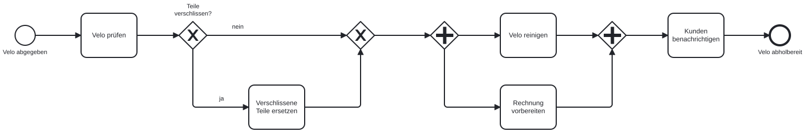

# Vortest: Vortest: Veloservice

Zeit: 15 Minuten

## Aufgabe

Eine Velowerkstatt bietet einen Jahresservice an. Der Ablauf beginnt, wenn ein Kunde sein Velo abgegeben hat. Die Mechanikerin prüft das Velo. Sind Teile verschlissen, ersetzt sie die verschlissenen Teile; sonst entfällt dieser Schritt. Danach reinigt die Mechanikerin das Velo, während der Empfang gleichzeitig die Rechnung vorbereitet. Sind beide Arbeiten erledigt, benachrichtigt der Empfang den Kunden. Der Ablauf endet, wenn das Velo abholbereit ist. Modellieren Sie den Ablauf. Rollen müssen nicht dargestellt werden.

## Lernziel

Kenntnisse zu Aktivitäten, Ereignissen, XOR und AND vor dem Kurs erheben.

Elemente: start and end event, task, XOR, AND

## Musterlösung

BPMN: [solution.de.bpmn](solution.de.bpmn)

## Typische Fehler

- XOR-Pfad ohne Aktivität fehlt ("sonst entfällt dieser Schritt").
- Reinigen und Rechnung hintereinander statt parallel.
- AND-Join fehlt vor dem Benachrichtigen.

---
Lizenz: CC BY 4.0
