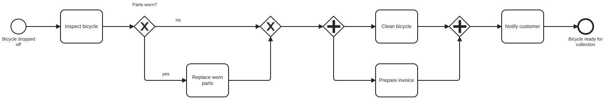

# Pre-test: Pre-test: bicycle service

Time: 15 minutes

## Task

A bicycle workshop offers an annual service. The process starts when a customer has dropped off his bicycle. The mechanic inspects the bicycle. If parts are worn, she replaces the worn parts; otherwise this step is skipped. The mechanic then cleans the bicycle while reception prepares the invoice at the same time. When both are done, reception notifies the customer. The process ends when the bicycle is ready for collection. Model the process. Roles do not need to be shown.

## Learning goal

Measure knowledge of activities, events, XOR and AND before the course.

Elements: start and end event, task, XOR, AND

## Sample solution

BPMN: [solution.en.bpmn](solution.en.bpmn)

## Typical mistakes

- XOR path without an activity missing ("otherwise this step is skipped").
- Cleaning and invoice in sequence instead of in parallel.
- AND join missing before notifying.

---
Licence: CC BY 4.0
