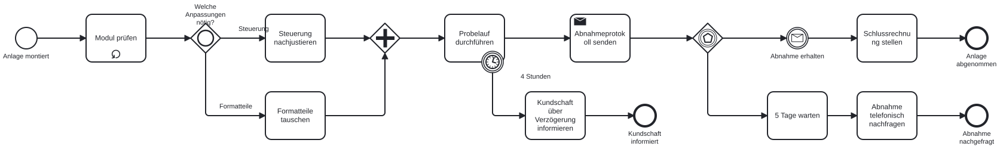
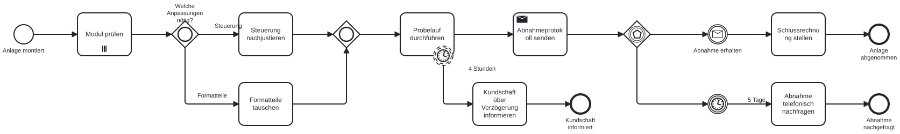

# EA-Q2-1: Inbetriebnahme einer Abfüllanlage

Advanced-Prüfung, Q2, Version A · 8 Punkte · 12 Minuten · Branche: machinery

## Aufgabe

Ein Hersteller von Abfüllanlagen nimmt Anlagen bei der Kundschaft in Betrieb. Ist eine Anlage montiert, prüft das Inbetriebnahmeteam jedes Modul der Anlage; die Prüfungen der Module laufen gleichzeitig. Danach entscheidet die Projektleitung, welche Anpassungen nötig sind: Die Steuerung wird nachjustiert, die Formatteile werden getauscht, oder beides. Sind alle nötigen Anpassungen erledigt, führt das Team den Probelauf durch. Dauert der Probelauf länger als 4 Stunden, informiert die Projektleitung die Kundschaft über die Verzögerung; der Probelauf läuft dabei weiter. Nach dem Probelauf sendet die Projektleitung das Abnahmeprotokoll. Trifft die unterschriebene Abnahme ein, stellt die Buchhaltung die Schlussrechnung, und die Anlage ist abgenommen. Trifft innerhalb von 5 Tagen keine Abnahme ein, fragt die Projektleitung telefonisch nach.

Das Modell enthält genau vier Fehler gegenüber dem Text und den Modellierungsregeln. Markieren Sie jeden Fehler, benennen Sie ihn und korrigieren Sie ihn.

BPMN: [model.de.bpmn](model.de.bpmn)

## Lösung

BPMN: [solution.de.bpmn](solution.de.bpmn)

## Bewertung

1. «Modul prüfen» hat einen Schleifenmarker; laut Text laufen die Durchgänge gleichzeitig. **Korrektur:** Marker für parallele Mehrfachinstanz (drei senkrechte Striche). (2 Punkte)
2. Das OR-Split wird mit einem AND-Join geschlossen; wird nur ein Pfad aktiviert, wartet der Join ewig (Deadlock). **Korrektur:** OR-Join verwenden. (2 Punkte)
3. Das Zeit-Randereignis «4 Stunden» ist unterbrechend; laut Text läuft «Probelauf durchführen» weiter. **Korrektur:** Nicht unterbrechendes Zeit-Randereignis (gestrichelter Rand). (2 Punkte)
4. Nach dem ereignisbasierten Gateway folgt die Aktivität «5 Tage warten»; dort sind nur eintretende Ereignisse oder Empfangsaufgaben erlaubt. **Korrektur:** Zeit-Zwischenereignis «5 Tage». (2 Punkte)

Pro Fehler 1 Punkt für das Erkennen und Benennen, 1 Punkt für die richtige Korrektur.
