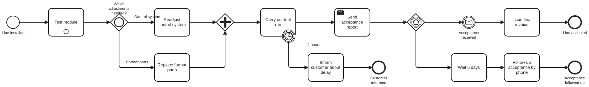
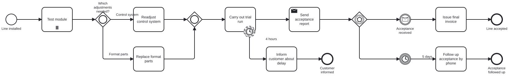

# EA-Q2-1: Commissioning a filling line

Advanced exam, Q2, Version A · 8 points · 12 minutes · Industry: machinery

## Task

A manufacturer of filling lines commissions lines at the customer's site. When a line has been installed, the commissioning team tests every module of the line; the module tests run at the same time. The project manager then decides which adjustments are needed: the control system is readjusted, the format parts are replaced, or both. When all required adjustments are done, the team carries out the trial run. If the trial run takes longer than 4 hours, the project manager informs the customer about the delay; the trial run continues. After the trial run the project manager sends the acceptance report. If the signed acceptance arrives, accounting issues the final invoice and the line is accepted. If no acceptance arrives within 5 days, the project manager follows up by phone.

The model contains exactly four errors with respect to the text and the modelling rules. Mark each error, name it and correct it.

BPMN: [model.en.bpmn](model.en.bpmn)

## Solution

BPMN: [solution.en.bpmn](solution.en.bpmn)

## Scoring

1. "Test module" has a loop marker; according to the text the instances run at the same time. **Fix:** Parallel multi-instance marker (three vertical bars). (2 points)
2. The OR split is closed with an AND join; if only one path is activated, the join waits forever (deadlock). **Fix:** Use an OR join. (2 points)
3. The timer boundary event "4 hours" is interrupting; according to the text "Carry out trial run" continues. **Fix:** Non-interrupting timer boundary event (dashed border). (2 points)
4. The event-based gateway is followed by the activity "Wait 5 days"; only catching events or receive tasks are allowed there. **Fix:** Intermediate timer event "5 days". (2 points)

Per error 1 point for finding and naming it, 1 point for the correct fix.
