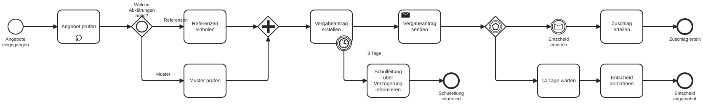
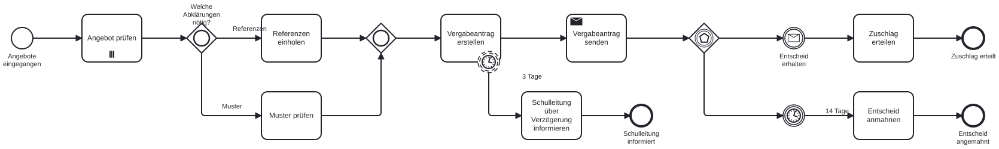

# EA-Q2-2: Beschaffung von Schulmobiliar

Advanced-Prüfung, Q2, Version B · 8 Punkte · 12 Minuten · Branche: public administration

## Aufgabe

Eine Gemeinde beschafft neues Mobiliar für ihre Schulen. Sind die Angebote eingegangen, prüft die Beschaffungsstelle jedes Angebot; die Angebote werden gleichzeitig von verschiedenen Personen geprüft. Danach entscheidet die Beschaffungsstelle, welche Abklärungen nötig sind: Sie holt Referenzen ein, sie prüft Muster, oder beides. Sind alle nötigen Abklärungen erledigt, erstellt sie den Vergabeantrag. Dauert das Erstellen länger als 3 Tage, informiert sie die Schulleitung über die Verzögerung; die Arbeit am Antrag geht weiter. Danach sendet die Beschaffungsstelle den Vergabeantrag an den Gemeinderat. Trifft der Entscheid ein, erteilt sie den Zuschlag. Trifft innerhalb von 14 Tagen kein Entscheid ein, mahnt sie den Entscheid an.

Das Modell enthält genau vier Fehler gegenüber dem Text und den Modellierungsregeln. Markieren Sie jeden Fehler, benennen Sie ihn und korrigieren Sie ihn.

BPMN: [model.de.bpmn](model.de.bpmn)

## Lösung

BPMN: [solution.de.bpmn](solution.de.bpmn)

## Bewertung

1. «Angebot prüfen» hat einen Schleifenmarker; laut Text laufen die Durchgänge gleichzeitig. **Korrektur:** Marker für parallele Mehrfachinstanz (drei senkrechte Striche). (2 Punkte)
2. Das OR-Split wird mit einem AND-Join geschlossen; wird nur ein Pfad aktiviert, wartet der Join ewig (Deadlock). **Korrektur:** OR-Join verwenden. (2 Punkte)
3. Das Zeit-Randereignis «3 Tage» ist unterbrechend; laut Text läuft «Vergabeantrag erstellen» weiter. **Korrektur:** Nicht unterbrechendes Zeit-Randereignis (gestrichelter Rand). (2 Punkte)
4. Nach dem ereignisbasierten Gateway folgt die Aktivität «14 Tage warten»; dort sind nur eintretende Ereignisse oder Empfangsaufgaben erlaubt. **Korrektur:** Zeit-Zwischenereignis «14 Tage». (2 Punkte)

Pro Fehler 1 Punkt für das Erkennen und Benennen, 1 Punkt für die richtige Korrektur.
