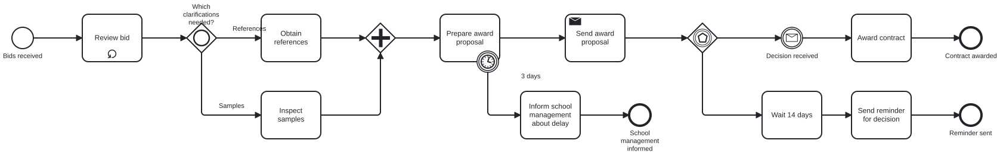
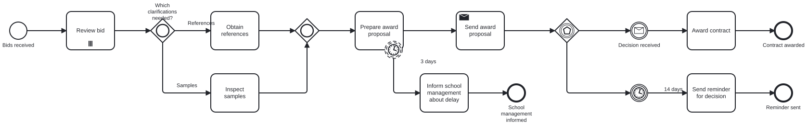

# EA-Q2-2: Procuring school furniture

Advanced exam, Q2, Version B · 8 points · 12 minutes · Industry: public administration

## Task

A municipality procures new furniture for its schools. When the bids have been received, the procurement office reviews every bid; the bids are reviewed by different people at the same time. The procurement office then decides which clarifications are needed: it obtains references, it inspects samples, or both. When all required clarifications are done, it prepares the award proposal. If preparing it takes longer than 3 days, it informs the school management about the delay; work on the proposal continues. The procurement office then sends the award proposal to the municipal council. If the decision arrives, it awards the contract. If no decision arrives within 14 days, it sends a reminder.

The model contains exactly four errors with respect to the text and the modelling rules. Mark each error, name it and correct it.

BPMN: [model.en.bpmn](model.en.bpmn)

## Solution

BPMN: [solution.en.bpmn](solution.en.bpmn)

## Scoring

1. "Review bid" has a loop marker; according to the text the instances run at the same time. **Fix:** Parallel multi-instance marker (three vertical bars). (2 points)
2. The OR split is closed with an AND join; if only one path is activated, the join waits forever (deadlock). **Fix:** Use an OR join. (2 points)
3. The timer boundary event "3 days" is interrupting; according to the text "Prepare award proposal" continues. **Fix:** Non-interrupting timer boundary event (dashed border). (2 points)
4. The event-based gateway is followed by the activity "Wait 14 days"; only catching events or receive tasks are allowed there. **Fix:** Intermediate timer event "14 days". (2 points)

Per error 1 point for finding and naming it, 1 point for the correct fix.
