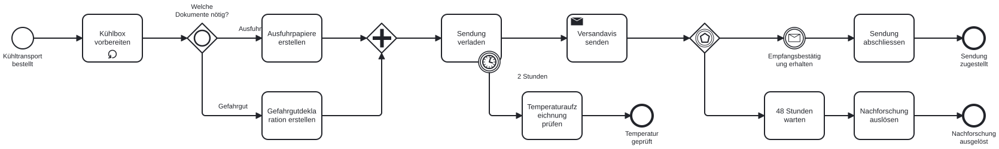
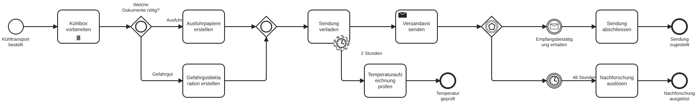

# EA-Q2-3: Kühltransport für Medikamente

Advanced-Prüfung, Q2, Version C · 8 Punkte · 12 Minuten · Branche: supply chain

## Aufgabe

Ein Logistikdienstleister transportiert Medikamente in Kühlboxen. Ist ein Kühltransport bestellt, bereitet das Lager jede Kühlbox der Sendung vor; mehrere Mitarbeitende bereiten die Kühlboxen gleichzeitig vor. Danach entscheidet die Versandabteilung, welche Dokumente nötig sind: Ausfuhrpapiere, eine Gefahrgutdeklaration, oder beides. Sind alle nötigen Dokumente erstellt, verlädt das Lager die Sendung. Dauert das Verladen länger als 2 Stunden, prüft die Qualitätssicherung die Temperaturaufzeichnung; das Verladen läuft dabei weiter. Danach sendet die Versandabteilung das Versandavis an den Empfänger. Trifft die Empfangsbestätigung ein, schliesst sie die Sendung ab. Trifft innerhalb von 48 Stunden keine Bestätigung ein, löst sie eine Nachforschung aus.

Das Modell enthält genau vier Fehler gegenüber dem Text und den Modellierungsregeln. Markieren Sie jeden Fehler, benennen Sie ihn und korrigieren Sie ihn.

BPMN: [model.de.bpmn](model.de.bpmn)

## Lösung

BPMN: [solution.de.bpmn](solution.de.bpmn)

## Bewertung

1. «Kühlbox vorbereiten» hat einen Schleifenmarker; laut Text laufen die Durchgänge gleichzeitig. **Korrektur:** Marker für parallele Mehrfachinstanz (drei senkrechte Striche). (2 Punkte)
2. Das OR-Split wird mit einem AND-Join geschlossen; wird nur ein Pfad aktiviert, wartet der Join ewig (Deadlock). **Korrektur:** OR-Join verwenden. (2 Punkte)
3. Das Zeit-Randereignis «2 Stunden» ist unterbrechend; laut Text läuft «Sendung verladen» weiter. **Korrektur:** Nicht unterbrechendes Zeit-Randereignis (gestrichelter Rand). (2 Punkte)
4. Nach dem ereignisbasierten Gateway folgt die Aktivität «48 Stunden warten»; dort sind nur eintretende Ereignisse oder Empfangsaufgaben erlaubt. **Korrektur:** Zeit-Zwischenereignis «48 Stunden». (2 Punkte)

Pro Fehler 1 Punkt für das Erkennen und Benennen, 1 Punkt für die richtige Korrektur.
