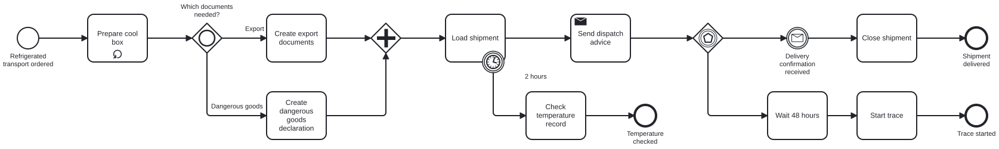
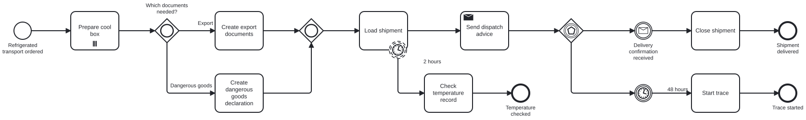

# EA-Q2-3: Refrigerated transport of medicines

Advanced exam, Q2, Version C · 8 points · 12 minutes · Industry: supply chain

## Task

A logistics service provider transports medicines in cool boxes. When a refrigerated transport has been ordered, the warehouse prepares every cool box of the shipment; several employees prepare the boxes at the same time. The shipping department then decides which documents are needed: export documents, a dangerous goods declaration, or both. When all required documents have been created, the warehouse loads the shipment. If loading takes longer than 2 hours, quality assurance checks the temperature record; loading continues. The shipping department then sends the dispatch advice to the consignee. If the delivery confirmation arrives, it closes the shipment. If no confirmation arrives within 48 hours, it starts a trace.

The model contains exactly four errors with respect to the text and the modelling rules. Mark each error, name it and correct it.

BPMN: [model.en.bpmn](model.en.bpmn)

## Solution

BPMN: [solution.en.bpmn](solution.en.bpmn)

## Scoring

1. "Prepare cool box" has a loop marker; according to the text the instances run at the same time. **Fix:** Parallel multi-instance marker (three vertical bars). (2 points)
2. The OR split is closed with an AND join; if only one path is activated, the join waits forever (deadlock). **Fix:** Use an OR join. (2 points)
3. The timer boundary event "2 hours" is interrupting; according to the text "Load shipment" continues. **Fix:** Non-interrupting timer boundary event (dashed border). (2 points)
4. The event-based gateway is followed by the activity "Wait 48 hours"; only catching events or receive tasks are allowed there. **Fix:** Intermediate timer event "48 hours". (2 points)

Per error 1 point for finding and naming it, 1 point for the correct fix.
