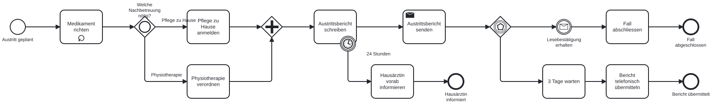
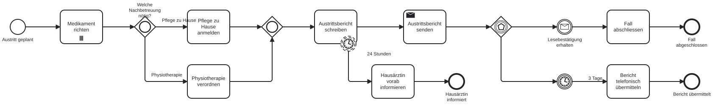

# EA-Q2-4: Austritt aus dem Spital

Advanced-Prüfung, Q2, Version D · 8 Punkte · 12 Minuten · Branche: health

## Aufgabe

Ein Spital bereitet den Austritt von Patientinnen vor. Ist ein Austritt geplant, richtet die Pflege jedes Austrittsmedikament; mehrere Pflegefachpersonen richten die Medikamente gleichzeitig. Danach entscheidet die Stationsärztin, welche Nachbetreuung nötig ist: Pflege zu Hause, Physiotherapie, oder beides. Sie meldet die Pflege zu Hause an beziehungsweise verordnet die Physiotherapie. Ist die Nachbetreuung organisiert, schreibt sie den Austrittsbericht. Ist der Bericht nach 24 Stunden noch nicht fertig, informiert sie die Hausärztin vorab; das Schreiben geht weiter. Danach sendet sie den Austrittsbericht. Trifft die Lesebestätigung der Hausärztin ein, schliesst das Sekretariat den Fall ab. Trifft innerhalb von 3 Tagen keine Bestätigung ein, übermittelt das Sekretariat den Bericht telefonisch.

Das Modell enthält genau vier Fehler gegenüber dem Text und den Modellierungsregeln. Markieren Sie jeden Fehler, benennen Sie ihn und korrigieren Sie ihn.

BPMN: [model.de.bpmn](model.de.bpmn)

## Lösung

BPMN: [solution.de.bpmn](solution.de.bpmn)

## Bewertung

1. «Medikament richten» hat einen Schleifenmarker; laut Text laufen die Durchgänge gleichzeitig. **Korrektur:** Marker für parallele Mehrfachinstanz (drei senkrechte Striche). (2 Punkte)
2. Das OR-Split wird mit einem AND-Join geschlossen; wird nur ein Pfad aktiviert, wartet der Join ewig (Deadlock). **Korrektur:** OR-Join verwenden. (2 Punkte)
3. Das Zeit-Randereignis «24 Stunden» ist unterbrechend; laut Text läuft «Austrittsbericht schreiben» weiter. **Korrektur:** Nicht unterbrechendes Zeit-Randereignis (gestrichelter Rand). (2 Punkte)
4. Nach dem ereignisbasierten Gateway folgt die Aktivität «3 Tage warten»; dort sind nur eintretende Ereignisse oder Empfangsaufgaben erlaubt. **Korrektur:** Zeit-Zwischenereignis «3 Tage». (2 Punkte)

Pro Fehler 1 Punkt für das Erkennen und Benennen, 1 Punkt für die richtige Korrektur.
