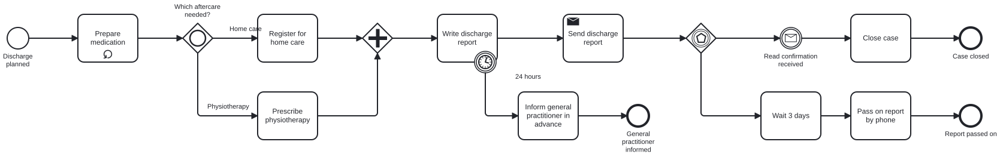
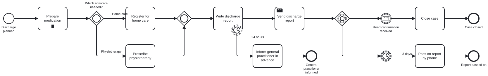

# EA-Q2-4: Hospital discharge

Advanced exam, Q2, Version D · 8 points · 12 minutes · Industry: health

## Task

A hospital prepares the discharge of patients. When a discharge has been planned, nursing prepares every discharge medication; several nurses prepare the medications at the same time. The ward doctor then decides which aftercare is needed: home care, physiotherapy, or both. She registers the patient for home care or prescribes physiotherapy respectively. When the aftercare is organised, she writes the discharge report. If the report is not finished after 24 hours, she informs the general practitioner in advance; writing continues. She then sends the discharge report. If the general practitioner's read confirmation arrives, the office closes the case. If no confirmation arrives within 3 days, the office passes on the report by phone.

The model contains exactly four errors with respect to the text and the modelling rules. Mark each error, name it and correct it.

BPMN: [model.en.bpmn](model.en.bpmn)

## Solution

BPMN: [solution.en.bpmn](solution.en.bpmn)

## Scoring

1. "Prepare medication" has a loop marker; according to the text the instances run at the same time. **Fix:** Parallel multi-instance marker (three vertical bars). (2 points)
2. The OR split is closed with an AND join; if only one path is activated, the join waits forever (deadlock). **Fix:** Use an OR join. (2 points)
3. The timer boundary event "24 hours" is interrupting; according to the text "Write discharge report" continues. **Fix:** Non-interrupting timer boundary event (dashed border). (2 points)
4. The event-based gateway is followed by the activity "Wait 3 days"; only catching events or receive tasks are allowed there. **Fix:** Intermediate timer event "3 days". (2 points)

Per error 1 point for finding and naming it, 1 point for the correct fix.
