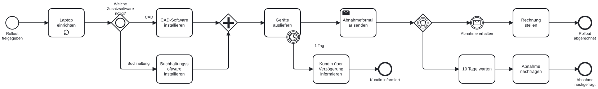
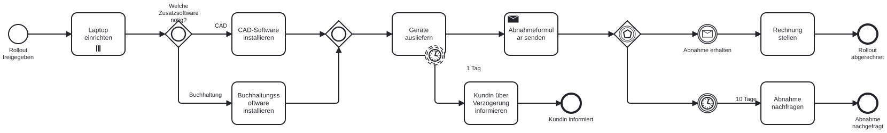

# EA-Q2-5: Laptops für eine Kundin ausrollen

Advanced-Prüfung, Q2, Version E · 8 Punkte · 12 Minuten · Branche: services

## Aufgabe

Ein IT-Dienstleister richtet Laptops für Firmenkundinnen ein. Ist ein Rollout freigegeben, richtet die Technik jeden Laptop ein; mehrere Technikerinnen arbeiten dabei gleichzeitig. Danach entscheidet die Projektleitung, welche Zusatzsoftware nötig ist: CAD-Software, Buchhaltungssoftware, oder beides. Ist die nötige Software installiert, liefert die Technik die Geräte aus. Dauert die Auslieferung länger als 1 Tag, informiert die Projektleitung die Kundin über die Verzögerung; die Auslieferung geht weiter. Danach sendet die Projektleitung das Abnahmeformular. Trifft die Abnahme ein, stellt die Buchhaltung die Rechnung, und der Rollout ist abgerechnet. Trifft innerhalb von 10 Tagen keine Abnahme ein, fragt die Projektleitung nach.

Das Modell enthält genau vier Fehler gegenüber dem Text und den Modellierungsregeln. Markieren Sie jeden Fehler, benennen Sie ihn und korrigieren Sie ihn.

BPMN: [model.de.bpmn](model.de.bpmn)

## Lösung

BPMN: [solution.de.bpmn](solution.de.bpmn)

## Bewertung

1. «Laptop einrichten» hat einen Schleifenmarker; laut Text laufen die Durchgänge gleichzeitig. **Korrektur:** Marker für parallele Mehrfachinstanz (drei senkrechte Striche). (2 Punkte)
2. Das OR-Split wird mit einem AND-Join geschlossen; wird nur ein Pfad aktiviert, wartet der Join ewig (Deadlock). **Korrektur:** OR-Join verwenden. (2 Punkte)
3. Das Zeit-Randereignis «1 Tag» ist unterbrechend; laut Text läuft «Geräte ausliefern» weiter. **Korrektur:** Nicht unterbrechendes Zeit-Randereignis (gestrichelter Rand). (2 Punkte)
4. Nach dem ereignisbasierten Gateway folgt die Aktivität «10 Tage warten»; dort sind nur eintretende Ereignisse oder Empfangsaufgaben erlaubt. **Korrektur:** Zeit-Zwischenereignis «10 Tage». (2 Punkte)

Pro Fehler 1 Punkt für das Erkennen und Benennen, 1 Punkt für die richtige Korrektur.
