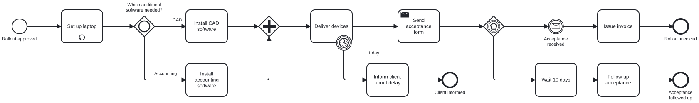
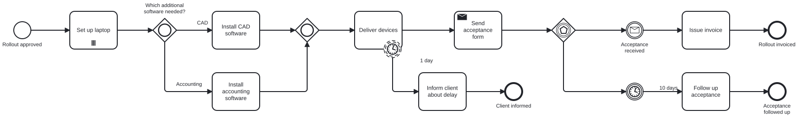

# EA-Q2-5: Rolling out laptops for a client

Advanced exam, Q2, Version E · 8 points · 12 minutes · Industry: services

## Task

An IT service provider sets up laptops for business clients. When a rollout has been approved, the technicians set up every laptop; several technicians work at the same time. The project manager then decides which additional software is needed: CAD software, accounting software, or both. When the required software has been installed, the technicians deliver the devices. If delivery takes longer than 1 day, the project manager informs the client about the delay; delivery continues. The project manager then sends the acceptance form. If the acceptance arrives, accounting issues the invoice and the rollout is invoiced. If no acceptance arrives within 10 days, the project manager follows up.

The model contains exactly four errors with respect to the text and the modelling rules. Mark each error, name it and correct it.

BPMN: [model.en.bpmn](model.en.bpmn)

## Solution

BPMN: [solution.en.bpmn](solution.en.bpmn)

## Scoring

1. "Set up laptop" has a loop marker; according to the text the instances run at the same time. **Fix:** Parallel multi-instance marker (three vertical bars). (2 points)
2. The OR split is closed with an AND join; if only one path is activated, the join waits forever (deadlock). **Fix:** Use an OR join. (2 points)
3. The timer boundary event "1 day" is interrupting; according to the text "Deliver devices" continues. **Fix:** Non-interrupting timer boundary event (dashed border). (2 points)
4. The event-based gateway is followed by the activity "Wait 10 days"; only catching events or receive tasks are allowed there. **Fix:** Intermediate timer event "10 days". (2 points)

Per error 1 point for finding and naming it, 1 point for the correct fix.
