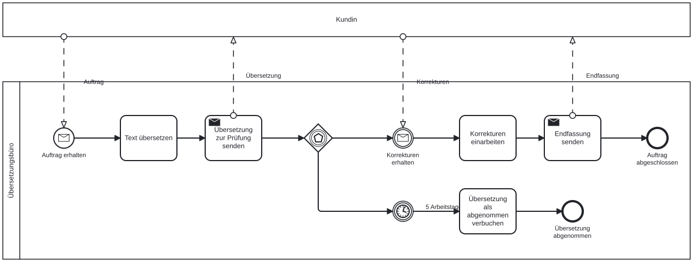

# EA-Q3-1: Fachübersetzung

Advanced-Prüfung, Q3, Version A · 12 Punkte · 20 Minuten · Branche: services

## Aufgabe

Ein Übersetzungsbüro übersetzt technische Dokumentationen. Der Ablauf beginnt, wenn der Auftrag einer Kundin eintrifft. Ein Übersetzer übersetzt den Text, und das Büro sendet die Übersetzung der Kundin zur Prüfung. Danach wartet das Büro: Treffen Korrekturen der Kundin ein, arbeitet der Übersetzer die Korrekturen ein, und das Büro sendet ihr die Endfassung. Damit ist der Auftrag abgeschlossen. Treffen innerhalb von 5 Arbeitstagen keine Korrekturen ein, verbucht das Büro die Übersetzung als abgenommen. Modellieren Sie den Ablauf des Übersetzungsbüros als eigenen Pool; die Kundin ist ein zugeklappter Pool. Benennen Sie alle Nachrichtenflüsse.

## Lösung

BPMN: [solution.de.bpmn](solution.de.bpmn)

## Bewertung

| Punkte | Bewertung |
|---|---|
| 2 | Eigener Pool «Übersetzungsbüro» und zugeklappter Pool «Kundin» |
| 1 | Nachrichten-Startereignis «Auftrag erhalten» |
| 3 | Vier Nachrichtenflüsse mit Richtung und Namen: «Auftrag», «Übersetzung», «Korrekturen», «Endfassung» |
| 1 | Nachrichtenflüsse nur zwischen den Pools, Sequenzflüsse nur im eigenen Pool |
| 2 | Ereignisbasiertes Gateway mit den beiden eintretenden Ereignissen |
| 1 | Zeit-Zwischenereignis «5 Arbeitstage» |
| 1 | Zwei Endereignisse mit den beiden Ergebnissen |
| 1 | Aktivitäten als Objekt und Verb benannt, Reihenfolge wie im Text |
