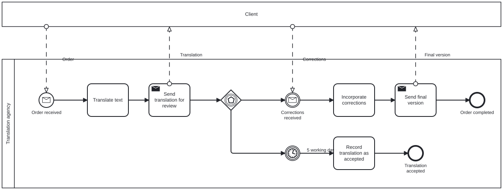

# EA-Q3-1: Specialist translation

Advanced exam, Q3, Version A · 12 points · 20 minutes · Industry: services

## Task

A translation agency translates technical documentation. The process starts when a client's order arrives. A translator translates the text and the agency sends the translation to the client for review. The agency then waits: if the client's corrections arrive, the translator incorporates the corrections and the agency sends her the final version. The order is then completed. If no corrections arrive within 5 working days, the agency records the translation as accepted. Model the translation agency's process as its own pool; the client is a collapsed pool. Name all message flows.

## Solution

BPMN: [solution.en.bpmn](solution.en.bpmn)

## Scoring

| points | Scoring |
|---|---|
| 2 | Own pool "Translation agency" and collapsed pool "Client" |
| 1 | Message start event "Order received" |
| 3 | Four message flows with direction and name: "Order", "Translation", "Corrections", "Final version" |
| 1 | Message flows only between the pools, sequence flows only inside the own pool |
| 2 | Event-based gateway followed by the two catching events |
| 1 | Intermediate timer event "5 working days" |
| 1 | Two end events with the two results |
| 1 | Activities named as verb and object, order as in the text |
