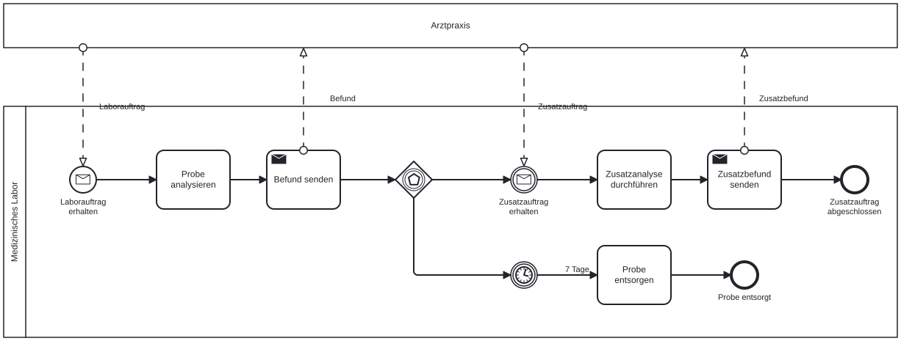

# EA-Q3-2: Laboranalyse für eine Arztpraxis

Advanced-Prüfung, Q3, Version B · 12 Punkte · 20 Minuten · Branche: health

## Aufgabe

Ein medizinisches Labor analysiert Proben für Arztpraxen. Der Ablauf beginnt, wenn ein Laborauftrag einer Arztpraxis eintrifft. Das Labor analysiert die Probe und sendet den Befund an die Praxis. Die Probe wird danach aufbewahrt: Trifft ein Zusatzauftrag der Praxis ein, führt das Labor die Zusatzanalyse durch und sendet den Zusatzbefund. Damit ist der Auftrag erweitert abgeschlossen. Trifft innerhalb von 7 Tagen kein Zusatzauftrag ein, entsorgt das Labor die Probe. Modellieren Sie den Ablauf des Labors als eigenen Pool; die Arztpraxis ist ein zugeklappter Pool. Benennen Sie alle Nachrichtenflüsse.

## Lösung

BPMN: [solution.de.bpmn](solution.de.bpmn)

## Bewertung

| Punkte | Bewertung |
|---|---|
| 2 | Eigener Pool «Medizinisches Labor» und zugeklappter Pool «Arztpraxis» |
| 1 | Nachrichten-Startereignis «Laborauftrag erhalten» |
| 3 | Vier Nachrichtenflüsse mit Richtung und Namen: «Laborauftrag», «Befund», «Zusatzauftrag», «Zusatzbefund» |
| 1 | Nachrichtenflüsse nur zwischen den Pools, Sequenzflüsse nur im eigenen Pool |
| 2 | Ereignisbasiertes Gateway mit den beiden eintretenden Ereignissen |
| 1 | Zeit-Zwischenereignis «7 Tage» |
| 1 | Zwei Endereignisse mit den beiden Ergebnissen |
| 1 | Aktivitäten als Objekt und Verb benannt, Reihenfolge wie im Text |
