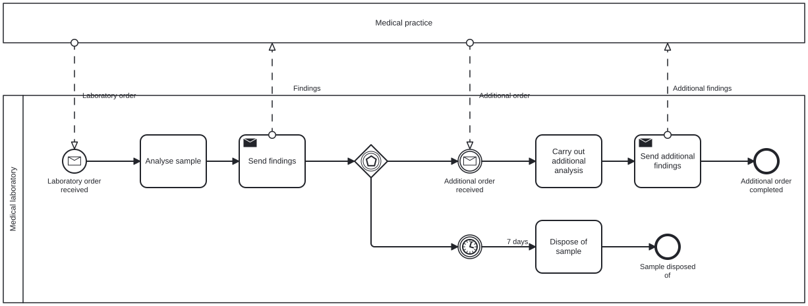

# EA-Q3-2: Laboratory analysis for a medical practice

Advanced exam, Q3, Version B · 12 points · 20 minutes · Industry: health

## Task

A medical laboratory analyses samples for medical practices. The process starts when a laboratory order from a practice arrives. The laboratory analyses the sample and sends the findings to the practice. The sample is then kept: if an additional order from the practice arrives, the laboratory carries out the additional analysis and sends the additional findings. The extended order is then completed. If no additional order arrives within 7 days, the laboratory disposes of the sample. Model the laboratory's process as its own pool; the medical practice is a collapsed pool. Name all message flows.

## Solution

BPMN: [solution.en.bpmn](solution.en.bpmn)

## Scoring

| points | Scoring |
|---|---|
| 2 | Own pool "Medical laboratory" and collapsed pool "Medical practice" |
| 1 | Message start event "Laboratory order received" |
| 3 | Four message flows with direction and name: "Laboratory order", "Findings", "Additional order", "Additional findings" |
| 1 | Message flows only between the pools, sequence flows only inside the own pool |
| 2 | Event-based gateway followed by the two catching events |
| 1 | Intermediate timer event "7 days" |
| 1 | Two end events with the two results |
| 1 | Activities named as verb and object, order as in the text |
