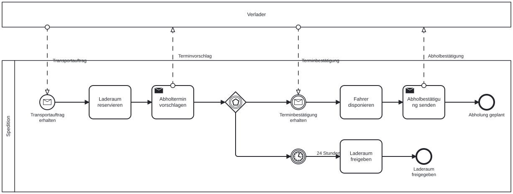

# EA-Q3-3: Abholung bei einem Verlader

Advanced-Prüfung, Q3, Version C · 12 Punkte · 20 Minuten · Branche: supply chain

## Aufgabe

Ein Speditionsunternehmen holt Ware bei Industriebetrieben ab. Der Ablauf beginnt, wenn der Transportauftrag eines Verladers eintrifft. Die Disposition reserviert Laderaum und schlägt dem Verlader einen Abholtermin vor. Danach wartet sie: Trifft die Terminbestätigung des Verladers ein, disponiert sie einen Fahrer und sendet dem Verlader die Abholbestätigung. Damit ist die Abholung geplant. Trifft innerhalb von 24 Stunden keine Bestätigung ein, gibt die Disposition den reservierten Laderaum wieder frei. Modellieren Sie den Ablauf der Spedition als eigenen Pool; der Verlader ist ein zugeklappter Pool. Benennen Sie alle Nachrichtenflüsse.

## Lösung

BPMN: [solution.de.bpmn](solution.de.bpmn)

## Bewertung

| Punkte | Bewertung |
|---|---|
| 2 | Eigener Pool «Spedition» und zugeklappter Pool «Verlader» |
| 1 | Nachrichten-Startereignis «Transportauftrag erhalten» |
| 3 | Vier Nachrichtenflüsse mit Richtung und Namen: «Transportauftrag», «Terminvorschlag», «Terminbestätigung», «Abholbestätigung» |
| 1 | Nachrichtenflüsse nur zwischen den Pools, Sequenzflüsse nur im eigenen Pool |
| 2 | Ereignisbasiertes Gateway mit den beiden eintretenden Ereignissen |
| 1 | Zeit-Zwischenereignis «24 Stunden» |
| 1 | Zwei Endereignisse mit den beiden Ergebnissen |
| 1 | Aktivitäten als Objekt und Verb benannt, Reihenfolge wie im Text |
