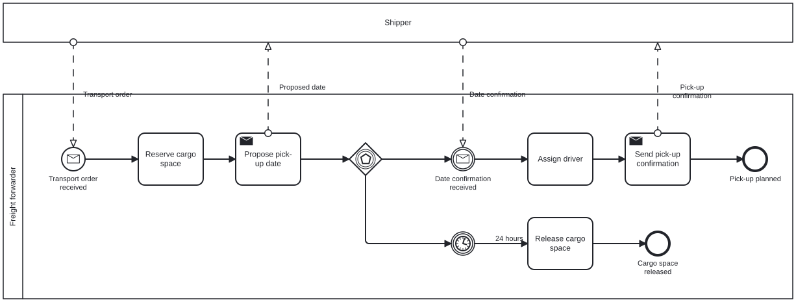

# EA-Q3-3: Pick-up from a shipper

Advanced exam, Q3, Version C · 12 points · 20 minutes · Industry: supply chain

## Task

A freight forwarder picks up goods from industrial companies. The process starts when a shipper's transport order arrives. Dispatch reserves cargo space and proposes a pick-up date to the shipper. It then waits: if the shipper's date confirmation arrives, dispatch assigns a driver and sends the pick-up confirmation to the shipper. The pick-up is then planned. If no confirmation arrives within 24 hours, dispatch releases the reserved cargo space again. Model the freight forwarder's process as its own pool; the shipper is a collapsed pool. Name all message flows.

## Solution

BPMN: [solution.en.bpmn](solution.en.bpmn)

## Scoring

| points | Scoring |
|---|---|
| 2 | Own pool "Freight forwarder" and collapsed pool "Shipper" |
| 1 | Message start event "Transport order received" |
| 3 | Four message flows with direction and name: "Transport order", "Proposed date", "Date confirmation", "Pick-up confirmation" |
| 1 | Message flows only between the pools, sequence flows only inside the own pool |
| 2 | Event-based gateway followed by the two catching events |
| 1 | Intermediate timer event "24 hours" |
| 1 | Two end events with the two results |
| 1 | Activities named as verb and object, order as in the text |
