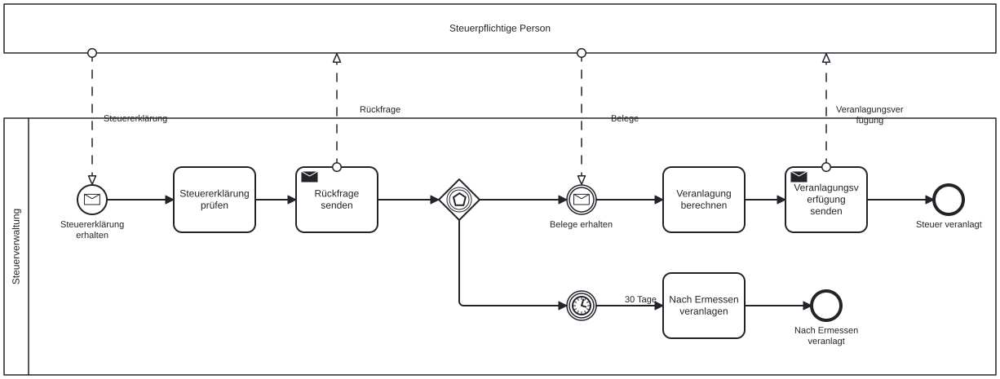

# EA-Q3-4: Veranlagung mit Rückfrage

Advanced-Prüfung, Q3, Version D · 12 Punkte · 20 Minuten · Branche: public administration

## Aufgabe

Eine Steuerverwaltung veranlagt die Steuern von Privatpersonen. Der Ablauf beginnt, wenn die Steuererklärung einer steuerpflichtigen Person eintrifft. Ein Steuerkommissär prüft die Steuererklärung und sendet der Person eine Rückfrage mit der Bitte um Belege. Danach wartet er: Treffen die Belege ein, berechnet er die Veranlagung und sendet der Person die Veranlagungsverfügung. Damit ist die Steuer veranlagt. Treffen innerhalb von 30 Tagen keine Belege ein, veranlagt er nach Ermessen. Modellieren Sie den Ablauf der Steuerverwaltung als eigenen Pool; die steuerpflichtige Person ist ein zugeklappter Pool. Benennen Sie alle Nachrichtenflüsse.

## Lösung

BPMN: [solution.de.bpmn](solution.de.bpmn)

## Bewertung

| Punkte | Bewertung |
|---|---|
| 2 | Eigener Pool «Steuerverwaltung» und zugeklappter Pool «Steuerpflichtige Person» |
| 1 | Nachrichten-Startereignis «Steuererklärung erhalten» |
| 3 | Vier Nachrichtenflüsse mit Richtung und Namen: «Steuererklärung», «Rückfrage», «Belege», «Veranlagungsverfügung» |
| 1 | Nachrichtenflüsse nur zwischen den Pools, Sequenzflüsse nur im eigenen Pool |
| 2 | Ereignisbasiertes Gateway mit den beiden eintretenden Ereignissen |
| 1 | Zeit-Zwischenereignis «30 Tage» |
| 1 | Zwei Endereignisse mit den beiden Ergebnissen |
| 1 | Aktivitäten als Objekt und Verb benannt, Reihenfolge wie im Text |
