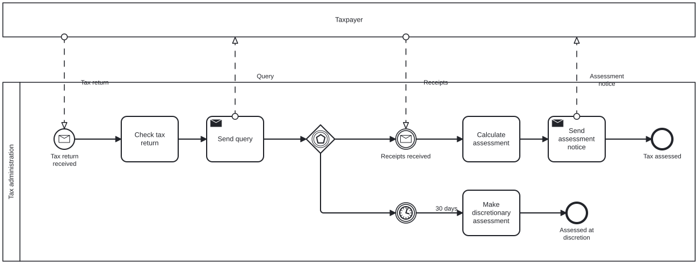

# EA-Q3-4: Tax assessment with a query

Advanced exam, Q3, Version D · 12 points · 20 minutes · Industry: public administration

## Task

A tax administration assesses the taxes of private individuals. The process starts when a taxpayer's tax return arrives. A tax officer checks the tax return and sends the taxpayer a query asking for receipts. He then waits: if the receipts arrive, he calculates the assessment and sends the taxpayer the assessment notice. The tax is then assessed. If no receipts arrive within 30 days, he makes a discretionary assessment. Model the tax administration's process as its own pool; the taxpayer is a collapsed pool. Name all message flows.

## Solution

BPMN: [solution.en.bpmn](solution.en.bpmn)

## Scoring

| points | Scoring |
|---|---|
| 2 | Own pool "Tax administration" and collapsed pool "Taxpayer" |
| 1 | Message start event "Tax return received" |
| 3 | Four message flows with direction and name: "Tax return", "Query", "Receipts", "Assessment notice" |
| 1 | Message flows only between the pools, sequence flows only inside the own pool |
| 2 | Event-based gateway followed by the two catching events |
| 1 | Intermediate timer event "30 days" |
| 1 | Two end events with the two results |
| 1 | Activities named as verb and object, order as in the text |
