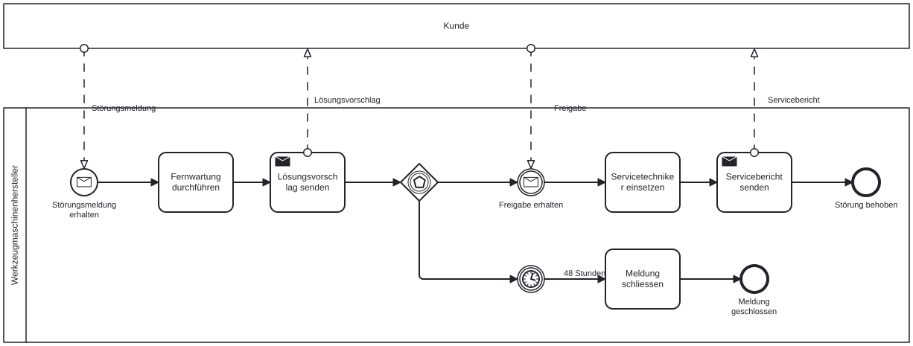

# EA-Q3-5: Störung an einer Werkzeugmaschine

Advanced-Prüfung, Q3, Version E · 12 Punkte · 20 Minuten · Branche: machinery

## Aufgabe

Ein Hersteller von Werkzeugmaschinen betreut die Maschinen seiner Kundschaft. Der Ablauf beginnt, wenn die Störungsmeldung eines Kunden eintrifft. Der Service führt eine Fernwartung durch und sendet dem Kunden einen Lösungsvorschlag mit Kosten. Danach wartet der Service: Trifft die Freigabe des Kunden ein, setzt er einen Servicetechniker vor Ort ein und sendet danach den Servicebericht. Damit ist die Störung behoben. Trifft innerhalb von 48 Stunden keine Freigabe ein, schliesst der Service die Meldung. Modellieren Sie den Ablauf des Herstellers als eigenen Pool; der Kunde ist ein zugeklappter Pool. Benennen Sie alle Nachrichtenflüsse.

## Lösung

BPMN: [solution.de.bpmn](solution.de.bpmn)

## Bewertung

| Punkte | Bewertung |
|---|---|
| 2 | Eigener Pool «Werkzeugmaschinenhersteller» und zugeklappter Pool «Kunde» |
| 1 | Nachrichten-Startereignis «Störungsmeldung erhalten» |
| 3 | Vier Nachrichtenflüsse mit Richtung und Namen: «Störungsmeldung», «Lösungsvorschlag», «Freigabe», «Servicebericht» |
| 1 | Nachrichtenflüsse nur zwischen den Pools, Sequenzflüsse nur im eigenen Pool |
| 2 | Ereignisbasiertes Gateway mit den beiden eintretenden Ereignissen |
| 1 | Zeit-Zwischenereignis «48 Stunden» |
| 1 | Zwei Endereignisse mit den beiden Ergebnissen |
| 1 | Aktivitäten als Objekt und Verb benannt, Reihenfolge wie im Text |
