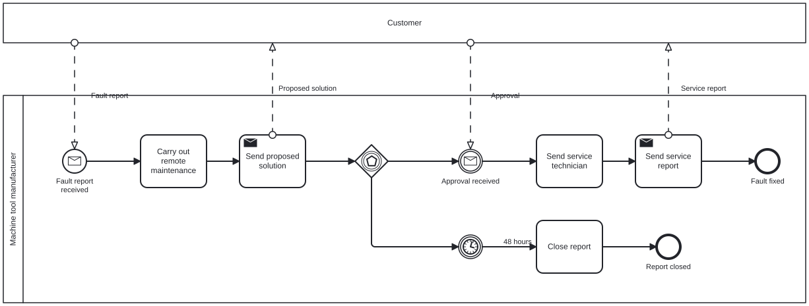

# EA-Q3-5: Fault on a machine tool

Advanced exam, Q3, Version E · 12 points · 20 minutes · Industry: machinery

## Task

A machine tool manufacturer services its customers' machines. The process starts when a customer's fault report arrives. Service carries out remote maintenance and sends the customer a proposed solution with costs. Service then waits: if the customer's approval arrives, it sends a service technician on site and then sends the service report. The fault is then fixed. If no approval arrives within 48 hours, service closes the report. Model the manufacturer's process as its own pool; the customer is a collapsed pool. Name all message flows.

## Solution

BPMN: [solution.en.bpmn](solution.en.bpmn)

## Scoring

| points | Scoring |
|---|---|
| 2 | Own pool "Machine tool manufacturer" and collapsed pool "Customer" |
| 1 | Message start event "Fault report received" |
| 3 | Four message flows with direction and name: "Fault report", "Proposed solution", "Approval", "Service report" |
| 1 | Message flows only between the pools, sequence flows only inside the own pool |
| 2 | Event-based gateway followed by the two catching events |
| 1 | Intermediate timer event "48 hours" |
| 1 | Two end events with the two results |
| 1 | Activities named as verb and object, order as in the text |
