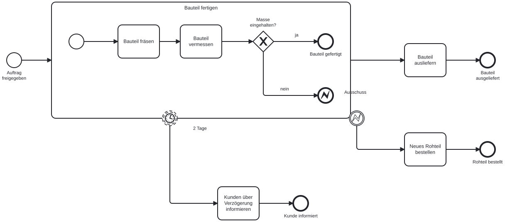

# EA-Q4-1: Sonderbauteil fertigen

Advanced-Prüfung, Q4, Version A · 12 Punkte · 20 Minuten · Branche: production

## Aufgabe

Ein Hersteller von Präzisionsteilen fertigt Sonderbauteile auf Bestellung. Ist ein Auftrag freigegeben, fertigt die Produktion das Bauteil: Sie fräst das Bauteil und vermisst es danach. Sind die Masse eingehalten, ist das Bauteil gefertigt. Andernfalls ist das Bauteil Ausschuss, und die Fertigung bricht ab; der Einkauf bestellt dann ein neues Rohteil. Dauert die Fertigung länger als 2 Tage, informiert der Verkauf den Kunden über die Verzögerung; die Fertigung läuft dabei weiter. Nach erfolgreicher Fertigung liefert der Versand das Bauteil aus. Modellieren Sie die Fertigung als aufgeklappten Teilprozess.

## Lösung

BPMN: [solution.de.bpmn](solution.de.bpmn)

## Bewertung

| Punkte | Bewertung |
|---|---|
| 2 | Aufgeklappter Teilprozess «Bauteil fertigen» mit Start, «Bauteil fräsen», «Bauteil vermessen» und Ende |
| 1 | XOR-Split mit Frage «Masse eingehalten?» und Ausgängen ja/nein |
| 2 | Fehler-Endereignis «Ausschuss» im Teilprozess |
| 2 | Fehler-Randereignis am Rand des Teilprozesses mit demselben Fehler |
| 1 | Fehlerbehandlung «Neues Rohteil bestellen» mit eigenem Endereignis |
| 2 | Nicht unterbrechendes Zeit-Randereignis «2 Tage» (gestrichelt) |
| 1 | Paralleler Pfad «Kunden über Verzögerung informieren» mit eigenem Endereignis |
| 1 | Normaler Ablauf nach dem Teilprozess: «Bauteil ausliefern» |
