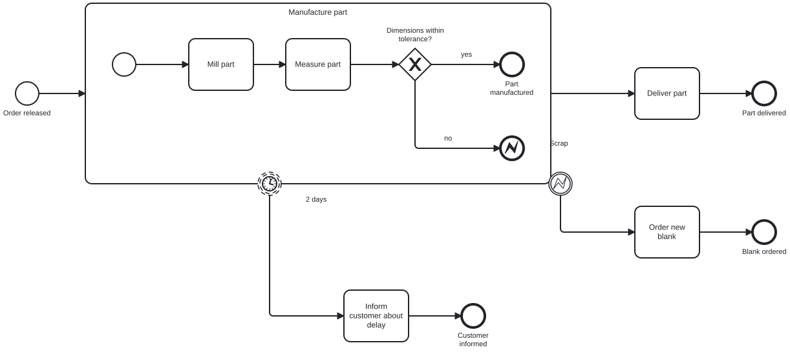

# EA-Q4-1: Manufacturing a special part

Advanced exam, Q4, Version A · 12 points · 20 minutes · Industry: production

## Task

A manufacturer of precision parts makes special parts to order. When an order has been released, production manufactures the part: it mills the part and then measures it. If the dimensions are within tolerance, the part is manufactured. Otherwise the part is scrap and manufacturing is aborted; purchasing then orders a new blank. If manufacturing takes longer than 2 days, sales informs the customer about the delay; manufacturing continues. After successful manufacturing, shipping delivers the part. Model the manufacturing as an expanded subprocess.

## Solution

BPMN: [solution.en.bpmn](solution.en.bpmn)

## Scoring

| points | Scoring |
|---|---|
| 2 | Expanded subprocess "Manufacture part" with start, "Mill part", "Measure part" and end |
| 1 | XOR split with question "Dimensions within tolerance?" and yes/no flows |
| 2 | Error end event "Scrap" inside the subprocess |
| 2 | Error boundary event on the subprocess border catching the same error |
| 1 | Error handling "Order new blank" with its own end event |
| 2 | Non-interrupting timer boundary event "2 days" (dashed) |
| 1 | Parallel path "Inform customer about delay" with its own end event |
| 1 | Normal flow after the subprocess: "Deliver part" |
