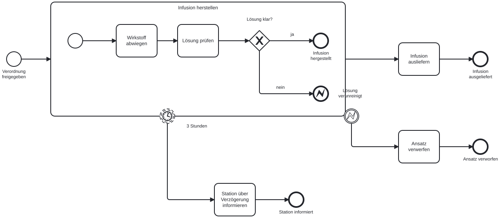

# EA-Q4-2: Infusion in der Spitalapotheke

Advanced-Prüfung, Q4, Version B · 12 Punkte · 20 Minuten · Branche: health

## Aufgabe

Eine Spitalapotheke stellt Infusionen für die Stationen her. Ist eine Verordnung freigegeben, stellt die Apotheke die Infusion her: Sie wiegt den Wirkstoff ab und prüft danach die Lösung. Ist die Lösung klar, ist die Infusion hergestellt. Andernfalls ist die Lösung verunreinigt, und die Herstellung bricht ab; die Apotheke verwirft dann den Ansatz. Dauert die Herstellung länger als 3 Stunden, informiert die Apotheke die Station über die Verzögerung; die Herstellung läuft dabei weiter. Nach erfolgreicher Herstellung liefert der Transportdienst die Infusion aus. Modellieren Sie die Herstellung als aufgeklappten Teilprozess.

## Lösung

BPMN: [solution.de.bpmn](solution.de.bpmn)

## Bewertung

| Punkte | Bewertung |
|---|---|
| 2 | Aufgeklappter Teilprozess «Infusion herstellen» mit Start, «Wirkstoff abwiegen», «Lösung prüfen» und Ende |
| 1 | XOR-Split mit Frage «Lösung klar?» und Ausgängen ja/nein |
| 2 | Fehler-Endereignis «Lösung verunreinigt» im Teilprozess |
| 2 | Fehler-Randereignis am Rand des Teilprozesses mit demselben Fehler |
| 1 | Fehlerbehandlung «Ansatz verwerfen» mit eigenem Endereignis |
| 2 | Nicht unterbrechendes Zeit-Randereignis «3 Stunden» (gestrichelt) |
| 1 | Paralleler Pfad «Station über Verzögerung informieren» mit eigenem Endereignis |
| 1 | Normaler Ablauf nach dem Teilprozess: «Infusion ausliefern» |
