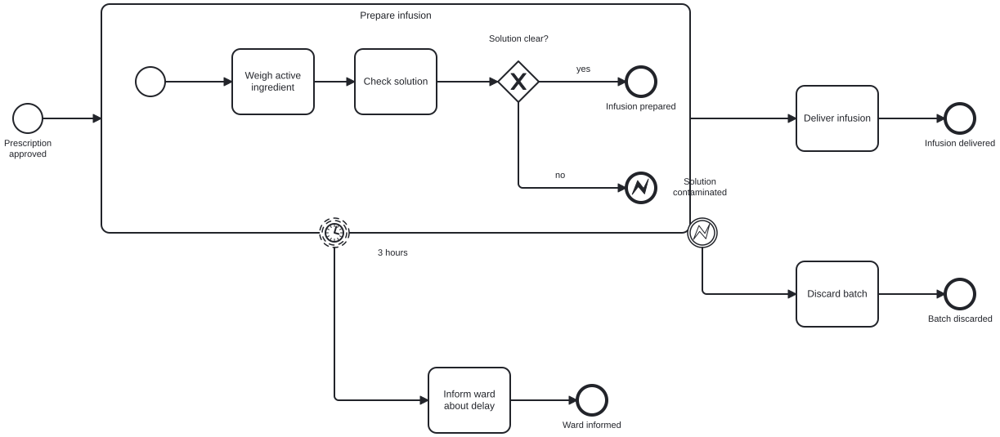

# EA-Q4-2: Preparing an infusion in a hospital pharmacy

Advanced exam, Q4, Version B · 12 points · 20 minutes · Industry: health

## Task

A hospital pharmacy prepares infusions for the wards. When a prescription has been approved, the pharmacy prepares the infusion: it weighs the active ingredient and then checks the solution. If the solution is clear, the infusion is prepared. Otherwise the solution is contaminated and preparation is aborted; the pharmacy then discards the batch. If preparation takes longer than 3 hours, the pharmacy informs the ward about the delay; preparation continues. After successful preparation, the transport service delivers the infusion. Model the preparation as an expanded subprocess.

## Solution

BPMN: [solution.en.bpmn](solution.en.bpmn)

## Scoring

| points | Scoring |
|---|---|
| 2 | Expanded subprocess "Prepare infusion" with start, "Weigh active ingredient", "Check solution" and end |
| 1 | XOR split with question "Solution clear?" and yes/no flows |
| 2 | Error end event "Solution contaminated" inside the subprocess |
| 2 | Error boundary event on the subprocess border catching the same error |
| 1 | Error handling "Discard batch" with its own end event |
| 2 | Non-interrupting timer boundary event "3 hours" (dashed) |
| 1 | Parallel path "Inform ward about delay" with its own end event |
| 1 | Normal flow after the subprocess: "Deliver infusion" |
