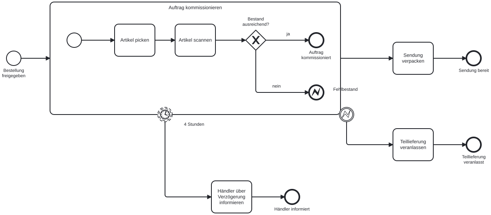

# EA-Q4-3: Auftrag kommissionieren

Advanced-Prüfung, Q4, Version C · 12 Punkte · 20 Minuten · Branche: supply chain

## Aufgabe

Ein Versandlager kommissioniert Bestellungen von Fachhändlern. Ist eine Bestellung freigegeben, kommissioniert das Lager den Auftrag: Ein Mitarbeiter pickt die Artikel und scannt sie danach. Ist der Bestand ausreichend, ist der Auftrag kommissioniert. Andernfalls liegt ein Fehlbestand vor, und die Kommissionierung bricht ab; die Disposition veranlasst dann eine Teillieferung. Dauert die Kommissionierung länger als 4 Stunden, informiert der Kundendienst den Händler über die Verzögerung; die Kommissionierung läuft dabei weiter. Nach erfolgreicher Kommissionierung verpackt das Lager die Sendung. Modellieren Sie die Kommissionierung als aufgeklappten Teilprozess.

## Lösung

BPMN: [solution.de.bpmn](solution.de.bpmn)

## Bewertung

| Punkte | Bewertung |
|---|---|
| 2 | Aufgeklappter Teilprozess «Auftrag kommissionieren» mit Start, «Artikel picken», «Artikel scannen» und Ende |
| 1 | XOR-Split mit Frage «Bestand ausreichend?» und Ausgängen ja/nein |
| 2 | Fehler-Endereignis «Fehlbestand» im Teilprozess |
| 2 | Fehler-Randereignis am Rand des Teilprozesses mit demselben Fehler |
| 1 | Fehlerbehandlung «Teillieferung veranlassen» mit eigenem Endereignis |
| 2 | Nicht unterbrechendes Zeit-Randereignis «4 Stunden» (gestrichelt) |
| 1 | Paralleler Pfad «Händler über Verzögerung informieren» mit eigenem Endereignis |
| 1 | Normaler Ablauf nach dem Teilprozess: «Sendung verpacken» |
