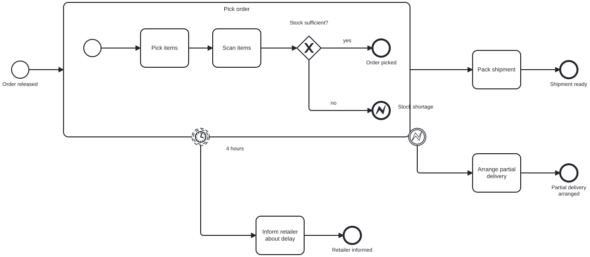

# EA-Q4-3: Picking an order

Advanced exam, Q4, Version C · 12 points · 20 minutes · Industry: supply chain

## Task

A distribution warehouse picks orders from specialist retailers. When an order has been released, the warehouse picks the order: an employee picks the items and then scans them. If the stock is sufficient, the order is picked. Otherwise there is a stock shortage and picking is aborted; dispatch then arranges a partial delivery. If picking takes longer than 4 hours, customer service informs the retailer about the delay; picking continues. After successful picking, the warehouse packs the shipment. Model the picking as an expanded subprocess.

## Solution

BPMN: [solution.en.bpmn](solution.en.bpmn)

## Scoring

| points | Scoring |
|---|---|
| 2 | Expanded subprocess "Pick order" with start, "Pick items", "Scan items" and end |
| 1 | XOR split with question "Stock sufficient?" and yes/no flows |
| 2 | Error end event "Stock shortage" inside the subprocess |
| 2 | Error boundary event on the subprocess border catching the same error |
| 1 | Error handling "Arrange partial delivery" with its own end event |
| 2 | Non-interrupting timer boundary event "4 hours" (dashed) |
| 1 | Parallel path "Inform retailer about delay" with its own end event |
| 1 | Normal flow after the subprocess: "Pack shipment" |
