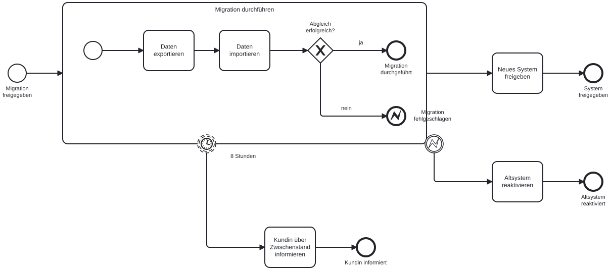

# EA-Q4-4: Datenmigration

Advanced-Prüfung, Q4, Version D · 12 Punkte · 20 Minuten · Branche: services

## Aufgabe

Ein IT-Dienstleister migriert die Daten von Kundinnen auf ein neues System. Ist die Migration freigegeben, führt das Projektteam die Migration durch: Es exportiert die Daten aus dem Altsystem und importiert sie danach in das neue System. Ist der Abgleich erfolgreich, ist die Migration durchgeführt. Andernfalls ist die Migration fehlgeschlagen und bricht ab; das Team reaktiviert dann das Altsystem. Dauert die Migration länger als 8 Stunden, informiert die Projektleitung die Kundin über den Zwischenstand; die Migration läuft dabei weiter. Nach erfolgreicher Migration gibt das Team das neue System frei. Modellieren Sie die Migration als aufgeklappten Teilprozess.

## Lösung

BPMN: [solution.de.bpmn](solution.de.bpmn)

## Bewertung

| Punkte | Bewertung |
|---|---|
| 2 | Aufgeklappter Teilprozess «Migration durchführen» mit Start, «Daten exportieren», «Daten importieren» und Ende |
| 1 | XOR-Split mit Frage «Abgleich erfolgreich?» und Ausgängen ja/nein |
| 2 | Fehler-Endereignis «Migration fehlgeschlagen» im Teilprozess |
| 2 | Fehler-Randereignis am Rand des Teilprozesses mit demselben Fehler |
| 1 | Fehlerbehandlung «Altsystem reaktivieren» mit eigenem Endereignis |
| 2 | Nicht unterbrechendes Zeit-Randereignis «8 Stunden» (gestrichelt) |
| 1 | Paralleler Pfad «Kundin über Zwischenstand informieren» mit eigenem Endereignis |
| 1 | Normaler Ablauf nach dem Teilprozess: «Neues System freigeben» |
