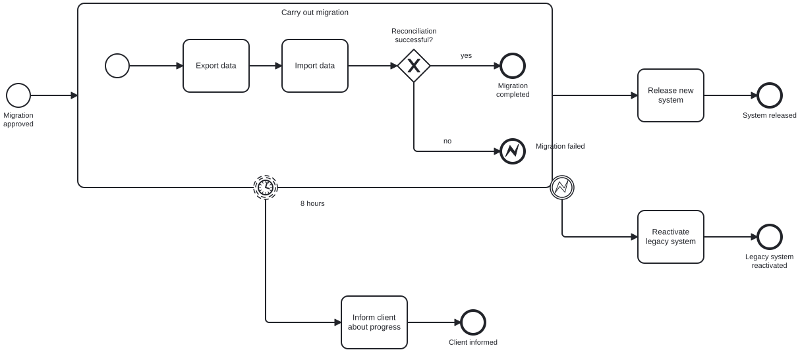

# EA-Q4-4: Data migration

Advanced exam, Q4, Version D · 12 points · 20 minutes · Industry: services

## Task

An IT service provider migrates clients' data to a new system. When the migration has been approved, the project team carries out the migration: it exports the data from the legacy system and then imports it into the new system. If the reconciliation is successful, the migration is completed. Otherwise the migration has failed and is aborted; the team then reactivates the legacy system. If the migration takes longer than 8 hours, the project manager informs the client about the progress; the migration continues. After a successful migration, the team releases the new system. Model the migration as an expanded subprocess.

## Solution

BPMN: [solution.en.bpmn](solution.en.bpmn)

## Scoring

| points | Scoring |
|---|---|
| 2 | Expanded subprocess "Carry out migration" with start, "Export data", "Import data" and end |
| 1 | XOR split with question "Reconciliation successful?" and yes/no flows |
| 2 | Error end event "Migration failed" inside the subprocess |
| 2 | Error boundary event on the subprocess border catching the same error |
| 1 | Error handling "Reactivate legacy system" with its own end event |
| 2 | Non-interrupting timer boundary event "8 hours" (dashed) |
| 1 | Parallel path "Inform client about progress" with its own end event |
| 1 | Normal flow after the subprocess: "Release new system" |
