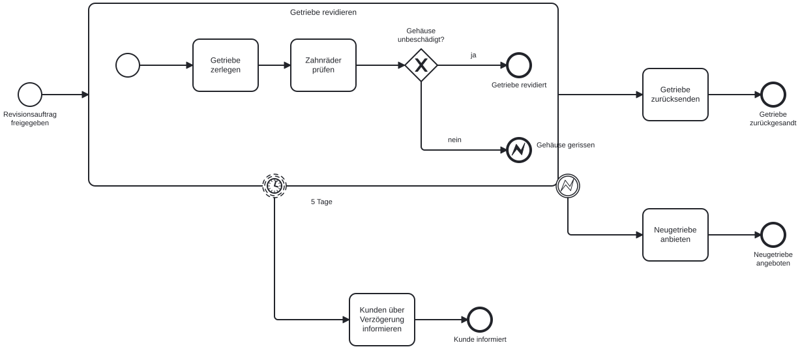

# EA-Q4-5: Getriebe revidieren

Advanced-Prüfung, Q4, Version E · 12 Punkte · 20 Minuten · Branche: machinery

## Aufgabe

Ein Hersteller von Industriegetrieben revidiert Getriebe seiner Kundschaft. Ist ein Revisionsauftrag freigegeben, revidiert die Werkstatt das Getriebe: Sie zerlegt das Getriebe und prüft danach die Zahnräder. Ist das Gehäuse unbeschädigt, ist das Getriebe revidiert. Andernfalls ist das Gehäuse gerissen, und die Revision bricht ab; der Verkauf bietet dann ein Neugetriebe an. Dauert die Revision länger als 5 Tage, informiert der Verkauf den Kunden über die Verzögerung; die Revision läuft dabei weiter. Nach erfolgreicher Revision sendet der Versand das Getriebe zurück. Modellieren Sie die Revision als aufgeklappten Teilprozess.

## Lösung

BPMN: [solution.de.bpmn](solution.de.bpmn)

## Bewertung

| Punkte | Bewertung |
|---|---|
| 2 | Aufgeklappter Teilprozess «Getriebe revidieren» mit Start, «Getriebe zerlegen», «Zahnräder prüfen» und Ende |
| 1 | XOR-Split mit Frage «Gehäuse unbeschädigt?» und Ausgängen ja/nein |
| 2 | Fehler-Endereignis «Gehäuse gerissen» im Teilprozess |
| 2 | Fehler-Randereignis am Rand des Teilprozesses mit demselben Fehler |
| 1 | Fehlerbehandlung «Neugetriebe anbieten» mit eigenem Endereignis |
| 2 | Nicht unterbrechendes Zeit-Randereignis «5 Tage» (gestrichelt) |
| 1 | Paralleler Pfad «Kunden über Verzögerung informieren» mit eigenem Endereignis |
| 1 | Normaler Ablauf nach dem Teilprozess: «Getriebe zurücksenden» |
