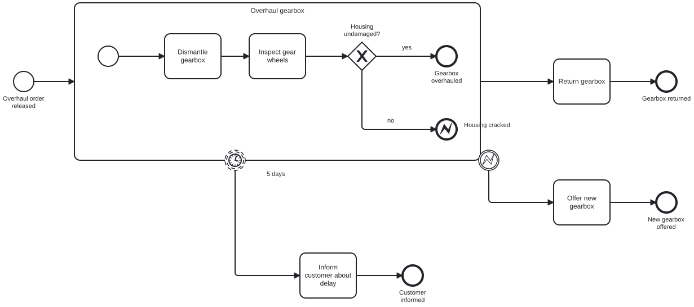

# EA-Q4-5: Overhauling a gearbox

Advanced exam, Q4, Version E · 12 points · 20 minutes · Industry: machinery

## Task

A manufacturer of industrial gearboxes overhauls its customers' gearboxes. When an overhaul order has been released, the workshop overhauls the gearbox: it dismantles the gearbox and then inspects the gear wheels. If the housing is undamaged, the gearbox is overhauled. Otherwise the housing is cracked and the overhaul is aborted; sales then offers a new gearbox. If the overhaul takes longer than 5 days, sales informs the customer about the delay; the overhaul continues. After a successful overhaul, shipping returns the gearbox. Model the overhaul as an expanded subprocess.

## Solution

BPMN: [solution.en.bpmn](solution.en.bpmn)

## Scoring

| points | Scoring |
|---|---|
| 2 | Expanded subprocess "Overhaul gearbox" with start, "Dismantle gearbox", "Inspect gear wheels" and end |
| 1 | XOR split with question "Housing undamaged?" and yes/no flows |
| 2 | Error end event "Housing cracked" inside the subprocess |
| 2 | Error boundary event on the subprocess border catching the same error |
| 1 | Error handling "Offer new gearbox" with its own end event |
| 2 | Non-interrupting timer boundary event "5 days" (dashed) |
| 1 | Parallel path "Inform customer about delay" with its own end event |
| 1 | Normal flow after the subprocess: "Return gearbox" |
