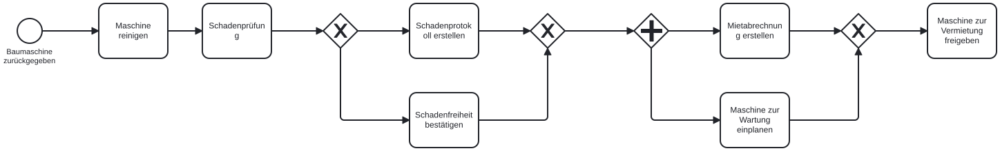
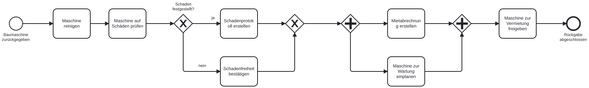

# EB-Q2-1: Rückgabe einer Baumaschine

Basic-Prüfung, Q2, Version A · 8 Punkte · 12 Minuten · Branche: machinery

## Aufgabe

Ein Vermieter von Baumaschinen nimmt zurückgegebene Maschinen entgegen. Wenn eine Maschine zurückgegeben wurde, reinigt die Werkstatt sie und prüft sie danach auf Schäden. Wird ein Schaden festgestellt, erstellt die Werkstatt ein Schadenprotokoll; andernfalls bestätigt sie die Schadenfreiheit. Danach erstellt die Disposition die Mietabrechnung, während die Werkstatt die Maschine gleichzeitig zur Wartung einplant. Sind beide Arbeiten erledigt, gibt die Disposition die Maschine wieder zur Vermietung frei. Damit ist die Rückgabe abgeschlossen.

Das Modell enthält genau vier Fehler gegenüber dem Text und den Modellierungsregeln. Markieren Sie jeden Fehler, benennen Sie ihn und korrigieren Sie ihn.

BPMN: [model.de.bpmn](model.de.bpmn)

## Lösung

BPMN: [solution.de.bpmn](solution.de.bpmn)

## Bewertung

1. Aktivität «Schadenprüfung» ist als Substantiv benannt (L1). **Korrektur:** Als Objekt und Verb benennen: «Maschine auf Schäden prüfen». (2 Punkte)
2. Das XOR-Gateway hat keine Frage und unbeschriftete Ausgänge (L4). **Korrektur:** Frage «Schaden festgestellt?» und Ausgänge «ja»/«nein». (2 Punkte)
3. Die parallelen Pfade werden mit einem XOR-Gateway statt mit einem AND-Gateway zusammengeführt (G4). **Korrektur:** AND-Join verwenden, damit beide Arbeiten abgeschlossen sind, bevor es weitergeht. (2 Punkte)
4. Nach «Maschine zur Vermietung freigeben» endet der Ablauf ohne Endereignis (G2). **Korrektur:** Endereignis «Rückgabe abgeschlossen» ergänzen. (2 Punkte)

Pro Fehler 1 Punkt für das Erkennen und Benennen, 1 Punkt für die richtige Korrektur.
