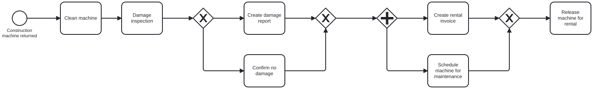
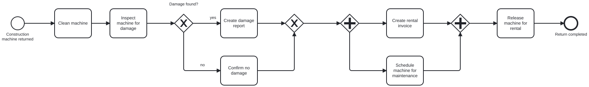

# EB-Q2-1: Return of a construction machine

Basic exam, Q2, Version A · 8 points · 12 minutes · Industry: machinery

## Task

A construction machinery rental company takes back returned machines. When a machine has been returned, the workshop cleans it and then inspects it for damage. If damage is found, the workshop creates a damage report; otherwise it confirms that there is no damage. Dispatch then creates the rental invoice while the workshop schedules the machine for maintenance at the same time. When both are done, dispatch releases the machine for rental again. This completes the return.

The model contains exactly four errors with respect to the text and the modelling rules. Mark each error, name it and correct it.

BPMN: [model.en.bpmn](model.en.bpmn)

## Solution

BPMN: [solution.en.bpmn](solution.en.bpmn)

## Scoring

1. Activity "Damage inspection" is named with a noun (L1). **Fix:** Name it as verb and object: "Inspect machine for damage". (2 points)
2. The XOR split has no question and unlabelled outgoing flows (L4). **Fix:** Question "Damage found?" and outgoing flows "yes"/"no". (2 points)
3. The parallel paths are joined with an XOR gateway instead of an AND gateway (G4). **Fix:** Use an AND join so that both pieces of work are finished before the process continues. (2 points)
4. After "Release machine for rental" the process stops without an end event (G2). **Fix:** Add the end event "Return completed". (2 points)

Per error 1 point for finding and naming it, 1 point for the correct fix.
