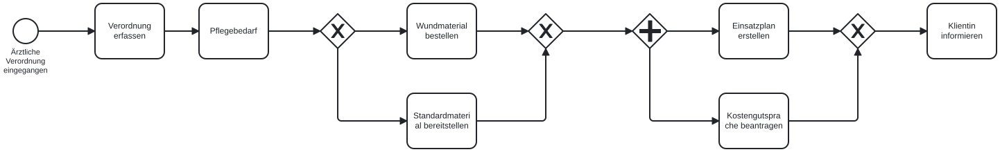
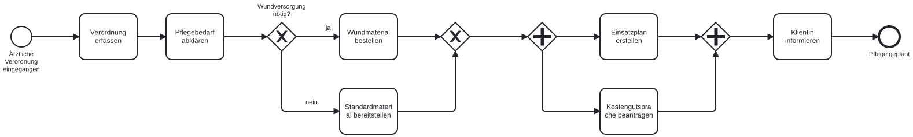

# EB-Q2-2: Pflegeauftrag planen

Basic-Prüfung, Q2, Version B · 8 Punkte · 12 Minuten · Branche: health

## Aufgabe

Eine Organisation für Pflege zu Hause erhält ärztliche Verordnungen. Ist eine Verordnung eingegangen, erfasst die Disposition sie, und eine Pflegefachfrau klärt danach den Pflegebedarf ab. Ist eine Wundversorgung nötig, bestellt sie Wundmaterial; andernfalls stellt sie Standardmaterial bereit. Anschliessend erstellt die Disposition den Einsatzplan, während die Administration gleichzeitig die Kostengutsprache bei der Krankenkasse beantragt. Sind beide Arbeiten erledigt, informiert die Disposition die Klientin. Damit ist die Pflege geplant.

Das Modell enthält genau vier Fehler gegenüber dem Text und den Modellierungsregeln. Markieren Sie jeden Fehler, benennen Sie ihn und korrigieren Sie ihn.

BPMN: [model.de.bpmn](model.de.bpmn)

## Lösung

BPMN: [solution.de.bpmn](solution.de.bpmn)

## Bewertung

1. Aktivität «Pflegebedarf» ist als Substantiv benannt (L1). **Korrektur:** Als Objekt und Verb benennen: «Pflegebedarf abklären». (2 Punkte)
2. Das XOR-Gateway hat keine Frage und unbeschriftete Ausgänge (L4). **Korrektur:** Frage «Wundversorgung nötig?» und Ausgänge «ja»/«nein». (2 Punkte)
3. Die parallelen Pfade werden mit einem XOR-Gateway statt mit einem AND-Gateway zusammengeführt (G4). **Korrektur:** AND-Join verwenden, damit beide Arbeiten abgeschlossen sind, bevor es weitergeht. (2 Punkte)
4. Nach «Klientin informieren» endet der Ablauf ohne Endereignis (G2). **Korrektur:** Endereignis «Pflege geplant» ergänzen. (2 Punkte)

Pro Fehler 1 Punkt für das Erkennen und Benennen, 1 Punkt für die richtige Korrektur.
