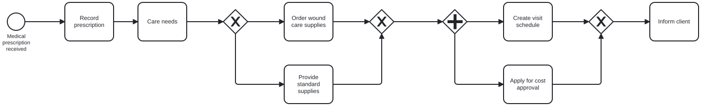
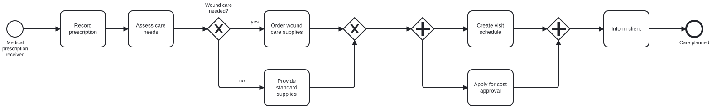

# EB-Q2-2: Planning a home care order

Basic exam, Q2, Version B · 8 points · 12 minutes · Industry: health

## Task

A home care organisation receives medical prescriptions. When a prescription has been received, dispatch records it and a nurse then assesses the care needs. If wound care is needed, she orders wound care supplies; otherwise she provides standard supplies. Dispatch then creates the visit schedule while administration applies for cost approval from the health insurer at the same time. When both are done, dispatch informs the client. The care is then planned.

The model contains exactly four errors with respect to the text and the modelling rules. Mark each error, name it and correct it.

BPMN: [model.en.bpmn](model.en.bpmn)

## Solution

BPMN: [solution.en.bpmn](solution.en.bpmn)

## Scoring

1. Activity "Care needs" is named with a noun (L1). **Fix:** Name it as verb and object: "Assess care needs". (2 points)
2. The XOR split has no question and unlabelled outgoing flows (L4). **Fix:** Question "Wound care needed?" and outgoing flows "yes"/"no". (2 points)
3. The parallel paths are joined with an XOR gateway instead of an AND gateway (G4). **Fix:** Use an AND join so that both pieces of work are finished before the process continues. (2 points)
4. After "Inform client" the process stops without an end event (G2). **Fix:** Add the end event "Care planned". (2 points)

Per error 1 point for finding and naming it, 1 point for the correct fix.
