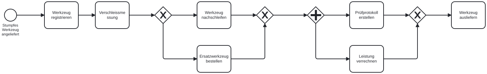
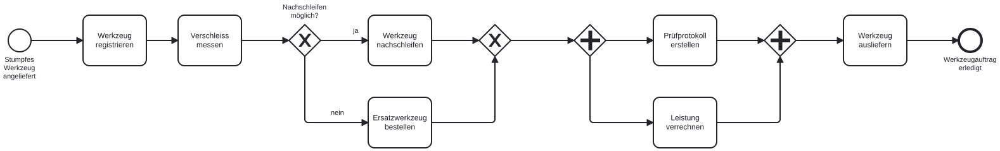

# EB-Q2-3: Werkzeug nachschleifen

Basic-Prüfung, Q2, Version C · 8 Punkte · 12 Minuten · Branche: production

## Aufgabe

Ein Werkzeughersteller schleift stumpfe Fräswerkzeuge seiner Kundschaft nach. Wird ein stumpfes Werkzeug angeliefert, registriert die Annahme es, und die Schleiferei misst danach den Verschleiss. Ist ein Nachschleifen möglich, schleift die Schleiferei das Werkzeug nach; andernfalls bestellt die Annahme ein Ersatzwerkzeug. Danach erstellt die Qualitätsprüfung das Prüfprotokoll, während die Buchhaltung gleichzeitig die Leistung verrechnet. Sind beide Arbeiten erledigt, liefert der Versand das Werkzeug aus. Damit ist der Werkzeugauftrag erledigt.

Das Modell enthält genau vier Fehler gegenüber dem Text und den Modellierungsregeln. Markieren Sie jeden Fehler, benennen Sie ihn und korrigieren Sie ihn.

BPMN: [model.de.bpmn](model.de.bpmn)

## Lösung

BPMN: [solution.de.bpmn](solution.de.bpmn)

## Bewertung

1. Aktivität «Verschleissmessung» ist als Substantiv benannt (L1). **Korrektur:** Als Objekt und Verb benennen: «Verschleiss messen». (2 Punkte)
2. Das XOR-Gateway hat keine Frage und unbeschriftete Ausgänge (L4). **Korrektur:** Frage «Nachschleifen möglich?» und Ausgänge «ja»/«nein». (2 Punkte)
3. Die parallelen Pfade werden mit einem XOR-Gateway statt mit einem AND-Gateway zusammengeführt (G4). **Korrektur:** AND-Join verwenden, damit beide Arbeiten abgeschlossen sind, bevor es weitergeht. (2 Punkte)
4. Nach «Werkzeug ausliefern» endet der Ablauf ohne Endereignis (G2). **Korrektur:** Endereignis «Werkzeugauftrag erledigt» ergänzen. (2 Punkte)

Pro Fehler 1 Punkt für das Erkennen und Benennen, 1 Punkt für die richtige Korrektur.
