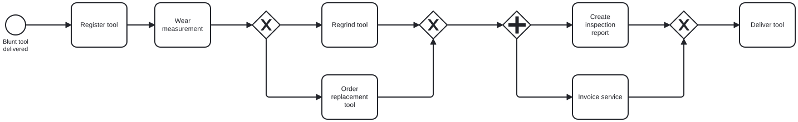
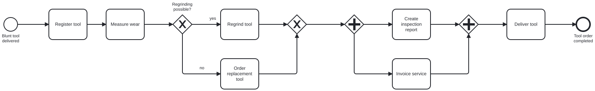

# EB-Q2-3: Regrinding a cutting tool

Basic exam, Q2, Version C · 8 points · 12 minutes · Industry: production

## Task

A tool manufacturer regrinds its customers' blunt milling tools. When a blunt tool is delivered, goods-in registers it and the grinding shop then measures the wear. If regrinding is possible, the grinding shop regrinds the tool; otherwise goods-in orders a replacement tool. Quality inspection then creates the inspection report while accounting invoices the service at the same time. When both are done, shipping delivers the tool. The tool order is then completed.

The model contains exactly four errors with respect to the text and the modelling rules. Mark each error, name it and correct it.

BPMN: [model.en.bpmn](model.en.bpmn)

## Solution

BPMN: [solution.en.bpmn](solution.en.bpmn)

## Scoring

1. Activity "Wear measurement" is named with a noun (L1). **Fix:** Name it as verb and object: "Measure wear". (2 points)
2. The XOR split has no question and unlabelled outgoing flows (L4). **Fix:** Question "Regrinding possible?" and outgoing flows "yes"/"no". (2 points)
3. The parallel paths are joined with an XOR gateway instead of an AND gateway (G4). **Fix:** Use an AND join so that both pieces of work are finished before the process continues. (2 points)
4. After "Deliver tool" the process stops without an end event (G2). **Fix:** Add the end event "Tool order completed". (2 points)

Per error 1 point for finding and naming it, 1 point for the correct fix.
