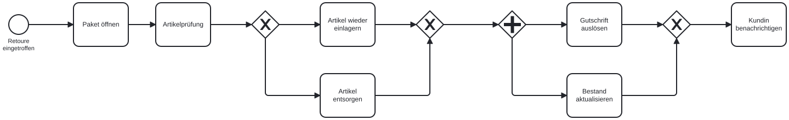
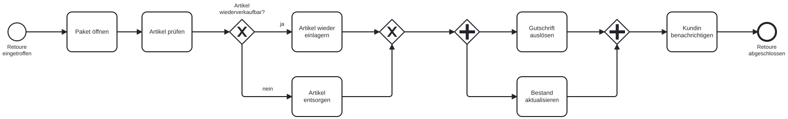

# EB-Q2-4: Retoure im Onlinehandel

Basic-Prüfung, Q2, Version D · 8 Punkte · 12 Minuten · Branche: supply chain

## Aufgabe

Das Logistikzentrum eines Onlinehändlers bearbeitet Rücksendungen. Ist eine Retoure eingetroffen, öffnet ein Mitarbeiter das Paket und prüft danach den Artikel. Ist der Artikel wiederverkaufbar, lagert er ihn wieder ein; andernfalls entsorgt er ihn. Danach löst der Kundendienst die Gutschrift aus, während die Lagerverwaltung gleichzeitig den Bestand aktualisiert. Sind beide Arbeiten erledigt, benachrichtigt der Kundendienst die Kundin. Damit ist die Retoure abgeschlossen.

Das Modell enthält genau vier Fehler gegenüber dem Text und den Modellierungsregeln. Markieren Sie jeden Fehler, benennen Sie ihn und korrigieren Sie ihn.

BPMN: [model.de.bpmn](model.de.bpmn)

## Lösung

BPMN: [solution.de.bpmn](solution.de.bpmn)

## Bewertung

1. Aktivität «Artikelprüfung» ist als Substantiv benannt (L1). **Korrektur:** Als Objekt und Verb benennen: «Artikel prüfen». (2 Punkte)
2. Das XOR-Gateway hat keine Frage und unbeschriftete Ausgänge (L4). **Korrektur:** Frage «Artikel wiederverkaufbar?» und Ausgänge «ja»/«nein». (2 Punkte)
3. Die parallelen Pfade werden mit einem XOR-Gateway statt mit einem AND-Gateway zusammengeführt (G4). **Korrektur:** AND-Join verwenden, damit beide Arbeiten abgeschlossen sind, bevor es weitergeht. (2 Punkte)
4. Nach «Kundin benachrichtigen» endet der Ablauf ohne Endereignis (G2). **Korrektur:** Endereignis «Retoure abgeschlossen» ergänzen. (2 Punkte)

Pro Fehler 1 Punkt für das Erkennen und Benennen, 1 Punkt für die richtige Korrektur.
