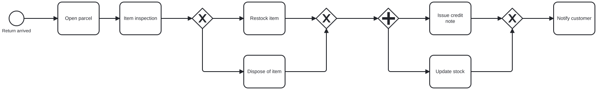
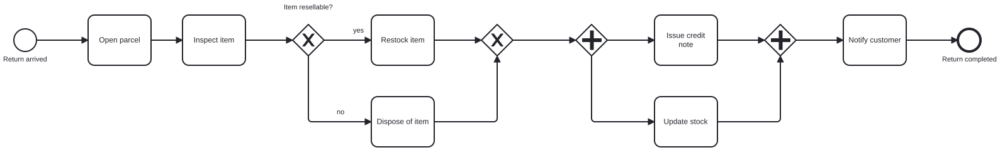

# EB-Q2-4: Handling an online return

Basic exam, Q2, Version D · 8 points · 12 minutes · Industry: supply chain

## Task

The logistics centre of an online retailer handles returns. When a return has arrived, an employee opens the parcel and then inspects the item. If the item can be resold, he restocks it; otherwise he disposes of it. Customer service then issues the credit note while inventory control updates the stock at the same time. When both are done, customer service notifies the customer. The return is then completed.

The model contains exactly four errors with respect to the text and the modelling rules. Mark each error, name it and correct it.

BPMN: [model.en.bpmn](model.en.bpmn)

## Solution

BPMN: [solution.en.bpmn](solution.en.bpmn)

## Scoring

1. Activity "Item inspection" is named with a noun (L1). **Fix:** Name it as verb and object: "Inspect item". (2 points)
2. The XOR split has no question and unlabelled outgoing flows (L4). **Fix:** Question "Item resellable?" and outgoing flows "yes"/"no". (2 points)
3. The parallel paths are joined with an XOR gateway instead of an AND gateway (G4). **Fix:** Use an AND join so that both pieces of work are finished before the process continues. (2 points)
4. After "Notify customer" the process stops without an end event (G2). **Fix:** Add the end event "Return completed". (2 points)

Per error 1 point for finding and naming it, 1 point for the correct fix.
