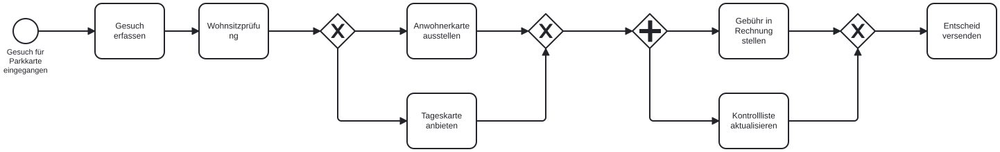
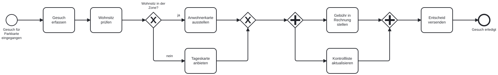

# EB-Q2-5: Anwohnerparkkarte

Basic-Prüfung, Q2, Version E · 8 Punkte · 12 Minuten · Branche: public administration

## Aufgabe

Eine Gemeinde stellt Parkkarten für die blaue Zone aus. Ist ein Gesuch eingegangen, erfasst die Einwohnerkontrolle es und prüft danach den Wohnsitz. Wohnt die gesuchstellende Person in der Zone, stellt die Einwohnerkontrolle eine Anwohnerkarte aus; andernfalls bietet sie eine Tageskarte an. Danach stellt die Finanzverwaltung die Gebühr in Rechnung, während die Gemeindepolizei gleichzeitig ihre Kontrollliste aktualisiert. Sind beide Arbeiten erledigt, versendet die Einwohnerkontrolle den Entscheid. Damit ist das Gesuch erledigt.

Das Modell enthält genau vier Fehler gegenüber dem Text und den Modellierungsregeln. Markieren Sie jeden Fehler, benennen Sie ihn und korrigieren Sie ihn.

BPMN: [model.de.bpmn](model.de.bpmn)

## Lösung

BPMN: [solution.de.bpmn](solution.de.bpmn)

## Bewertung

1. Aktivität «Wohnsitzprüfung» ist als Substantiv benannt (L1). **Korrektur:** Als Objekt und Verb benennen: «Wohnsitz prüfen». (2 Punkte)
2. Das XOR-Gateway hat keine Frage und unbeschriftete Ausgänge (L4). **Korrektur:** Frage «Wohnsitz in der Zone?» und Ausgänge «ja»/«nein». (2 Punkte)
3. Die parallelen Pfade werden mit einem XOR-Gateway statt mit einem AND-Gateway zusammengeführt (G4). **Korrektur:** AND-Join verwenden, damit beide Arbeiten abgeschlossen sind, bevor es weitergeht. (2 Punkte)
4. Nach «Entscheid versenden» endet der Ablauf ohne Endereignis (G2). **Korrektur:** Endereignis «Gesuch erledigt» ergänzen. (2 Punkte)

Pro Fehler 1 Punkt für das Erkennen und Benennen, 1 Punkt für die richtige Korrektur.
