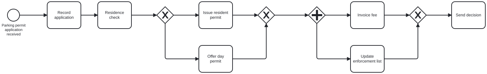
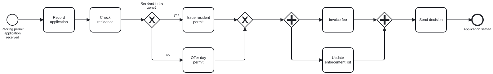

# EB-Q2-5: Resident parking permit

Basic exam, Q2, Version E · 8 points · 12 minutes · Industry: public administration

## Task

A municipality issues parking permits for its short-stay parking zone. When an application has been received, the residents' office records it and then checks the applicant's residence. If the applicant lives in the zone, the residents' office issues a resident permit; otherwise it offers a day permit. The finance department then invoices the fee while the municipal police update their enforcement list at the same time. When both are done, the residents' office sends the decision. The application is then settled.

The model contains exactly four errors with respect to the text and the modelling rules. Mark each error, name it and correct it.

BPMN: [model.en.bpmn](model.en.bpmn)

## Solution

BPMN: [solution.en.bpmn](solution.en.bpmn)

## Scoring

1. Activity "Residence check" is named with a noun (L1). **Fix:** Name it as verb and object: "Check residence". (2 points)
2. The XOR split has no question and unlabelled outgoing flows (L4). **Fix:** Question "Resident in the zone?" and outgoing flows "yes"/"no". (2 points)
3. The parallel paths are joined with an XOR gateway instead of an AND gateway (G4). **Fix:** Use an AND join so that both pieces of work are finished before the process continues. (2 points)
4. After "Send decision" the process stops without an end event (G2). **Fix:** Add the end event "Application settled". (2 points)

Per error 1 point for finding and naming it, 1 point for the correct fix.
