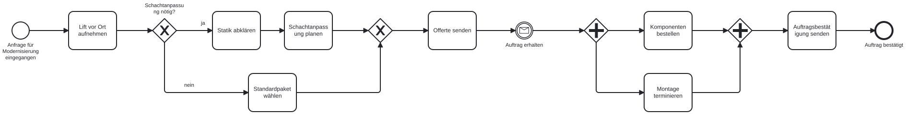

# EB-Q3-1: Liftmodernisierung offerieren

Basic-Prüfung, Q3, Version A · 12 Punkte · 20 Minuten · Branche: machinery

## Aufgabe

Ein Hersteller von Aufzügen modernisiert bestehende Anlagen. Ist eine Anfrage für eine Modernisierung eingegangen, nimmt ein Techniker den Lift vor Ort auf. Ist eine Anpassung des Schachts nötig, klärt die Konstruktion zuerst die Statik ab und plant danach die Schachtanpassung. Andernfalls wählt der Verkauf ein Standardpaket. Anschliessend sendet der Verkauf die Offerte und wartet, bis der Auftrag der Kundschaft eintrifft. Danach bestellt der Einkauf die Komponenten, während die Montageleitung gleichzeitig die Montage terminiert. Sind beide Arbeiten erledigt, sendet der Verkauf die Auftragsbestätigung. Damit ist der Auftrag bestätigt. Modellieren Sie den Ablauf. Rollen müssen nicht dargestellt werden.

## Lösung

BPMN: [solution.de.bpmn](solution.de.bpmn)

## Bewertung

| Punkte | Bewertung |
|---|---|
| 1 | Startereignis als Zustand benannt |
| 1 | Endereignis als Ergebnis benannt |
| 1 | Alle Aktivitäten als Objekt und Verb benannt |
| 2 | XOR-Split mit Frage «Schachtanpassung nötig?» und Ausgängen ja/nein |
| 1 | XOR-Merge vor dem weiteren Ablauf |
| 2 | Nachrichten-Zwischenereignis (eintretend) «Auftrag erhalten» an der richtigen Stelle |
| 2 | AND-Split und AND-Join um die beiden gleichzeitigen Arbeiten |
| 2 | Reihenfolge aller Schritte wie im Text |
