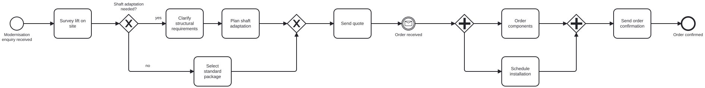

# EB-Q3-1: Quoting a lift modernisation

Basic exam, Q3, Version A · 12 points · 20 minutes · Industry: machinery

## Task

A lift manufacturer modernises existing installations. When an enquiry for a modernisation has been received, a technician surveys the lift on site. If the shaft needs to be adapted, engineering first clarifies the structural requirements and then plans the shaft adaptation. Otherwise sales selects a standard package. Sales then sends the quote and waits until the customer's order arrives. After that purchasing orders the components while the installation manager schedules the installation at the same time. When both are done, sales sends the order confirmation. The order is then confirmed. Model the process. Roles do not need to be shown.

## Solution

BPMN: [solution.en.bpmn](solution.en.bpmn)

## Scoring

| points | Scoring |
|---|---|
| 1 | Start event named as a state |
| 1 | End event named as the result |
| 1 | All activities named as verb and object |
| 2 | XOR split with question "Shaft adaptation needed?" and yes/no flows |
| 1 | XOR merge before the process continues |
| 2 | Intermediate message catch event "Order received" at the right place |
| 2 | AND split and AND join around the two concurrent tasks |
| 2 | Order of all steps as in the text |
