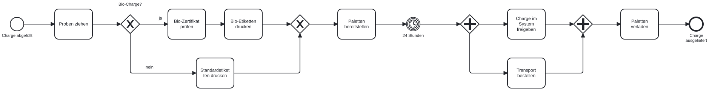

# EB-Q3-2: Joghurtcharge freigeben

Basic-Prüfung, Q3, Version B · 12 Punkte · 20 Minuten · Branche: production

## Aufgabe

Eine Molkerei füllt Joghurt in Chargen ab. Ist eine Charge abgefüllt, zieht die Qualitätssicherung Proben. Handelt es sich um eine Bio-Charge, prüft die Qualitätssicherung das Bio-Zertifikat des Milchlieferanten, und die Abfüllung druckt danach Bio-Etiketten. Andernfalls druckt die Abfüllung Standardetiketten. Anschliessend stellt das Lager die Paletten bereit. Die Paletten müssen danach 24 Stunden im Kühlraum lagern. Dann gibt die Qualitätssicherung die Charge im System frei, während die Logistik gleichzeitig den Transport bestellt. Sind beide Arbeiten erledigt, verlädt das Lager die Paletten. Damit ist die Charge ausgeliefert. Modellieren Sie den Ablauf. Rollen müssen nicht dargestellt werden.

## Lösung

BPMN: [solution.de.bpmn](solution.de.bpmn)

## Bewertung

| Punkte | Bewertung |
|---|---|
| 1 | Startereignis als Zustand benannt |
| 1 | Endereignis als Ergebnis benannt |
| 1 | Alle Aktivitäten als Objekt und Verb benannt |
| 2 | XOR-Split mit Frage «Bio-Charge?» und Ausgängen ja/nein |
| 1 | XOR-Merge vor dem weiteren Ablauf |
| 2 | Zwischenereignis (Zeit) «24 Stunden» an der richtigen Stelle |
| 2 | AND-Split und AND-Join um die beiden gleichzeitigen Arbeiten |
| 2 | Reihenfolge aller Schritte wie im Text |
