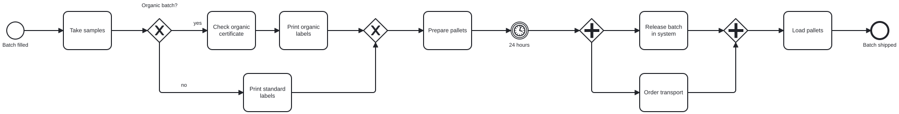

# EB-Q3-2: Releasing a yoghurt batch

Basic exam, Q3, Version B · 12 points · 20 minutes · Industry: production

## Task

A dairy fills yoghurt in batches. When a batch has been filled, quality assurance takes samples. If it is an organic batch, quality assurance checks the milk supplier's organic certificate and filling then prints organic labels. Otherwise filling prints standard labels. The warehouse then prepares the pallets. The pallets must then be stored in the cold room for 24 hours. After that quality assurance releases the batch in the system while logistics orders the transport at the same time. When both are done, the warehouse loads the pallets. The batch is then shipped. Model the process. Roles do not need to be shown.

## Solution

BPMN: [solution.en.bpmn](solution.en.bpmn)

## Scoring

| points | Scoring |
|---|---|
| 1 | Start event named as a state |
| 1 | End event named as the result |
| 1 | All activities named as verb and object |
| 2 | XOR split with question "Organic batch?" and yes/no flows |
| 1 | XOR merge before the process continues |
| 2 | Intermediate timer event "24 hours" at the right place |
| 2 | AND split and AND join around the two concurrent tasks |
| 2 | Order of all steps as in the text |
