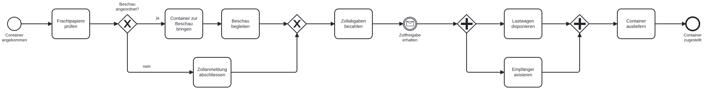

# EB-Q3-3: Importcontainer verzollen

Basic-Prüfung, Q3, Version C · 12 Punkte · 20 Minuten · Branche: supply chain

## Aufgabe

Ein Speditionsunternehmen organisiert die Verzollung von Importcontainern. Ist ein Container angekommen, prüft die Zollabteilung die Frachtpapiere. Ordnet der Zoll eine Beschau an, bringt die Disposition den Container zur Beschau, und die Zollabteilung begleitet danach die Beschau. Andernfalls schliesst die Zollabteilung die Zollanmeldung direkt ab. Anschliessend bezahlt die Buchhaltung die Zollabgaben, und die Zollabteilung wartet, bis die Freigabe des Zolls eintrifft. Danach disponiert die Disposition einen Lastwagen, während der Kundendienst gleichzeitig den Empfänger avisiert. Sind beide Arbeiten erledigt, liefert der Fahrer den Container aus. Damit ist der Container zugestellt. Modellieren Sie den Ablauf. Rollen müssen nicht dargestellt werden.

## Lösung

BPMN: [solution.de.bpmn](solution.de.bpmn)

## Bewertung

| Punkte | Bewertung |
|---|---|
| 1 | Startereignis als Zustand benannt |
| 1 | Endereignis als Ergebnis benannt |
| 1 | Alle Aktivitäten als Objekt und Verb benannt |
| 2 | XOR-Split mit Frage «Beschau angeordnet?» und Ausgängen ja/nein |
| 1 | XOR-Merge vor dem weiteren Ablauf |
| 2 | Nachrichten-Zwischenereignis (eintretend) «Zollfreigabe erhalten» an der richtigen Stelle |
| 2 | AND-Split und AND-Join um die beiden gleichzeitigen Arbeiten |
| 2 | Reihenfolge aller Schritte wie im Text |
