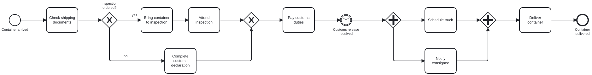

# EB-Q3-3: Clearing an import container

Basic exam, Q3, Version C · 12 points · 20 minutes · Industry: supply chain

## Task

A freight forwarder organises customs clearance for import containers. When a container has arrived, the customs department checks the shipping documents. If customs orders an inspection, dispatch brings the container to the inspection and the customs department then attends the inspection. Otherwise the customs department completes the customs declaration directly. Accounting then pays the customs duties and the customs department waits until the release from customs arrives. After that dispatch schedules a truck while customer service notifies the consignee at the same time. When both are done, the driver delivers the container. The container is then delivered. Model the process. Roles do not need to be shown.

## Solution

BPMN: [solution.en.bpmn](solution.en.bpmn)

## Scoring

| points | Scoring |
|---|---|
| 1 | Start event named as a state |
| 1 | End event named as the result |
| 1 | All activities named as verb and object |
| 2 | XOR split with question "Inspection ordered?" and yes/no flows |
| 1 | XOR merge before the process continues |
| 2 | Intermediate message catch event "Customs release received" at the right place |
| 2 | AND split and AND join around the two concurrent tasks |
| 2 | Order of all steps as in the text |
