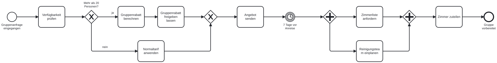

# EB-Q3-4: Gruppenbuchung im Hotel

Basic-Prüfung, Q3, Version D · 12 Punkte · 20 Minuten · Branche: services

## Aufgabe

Ein Hotel nimmt Buchungen von Reisegruppen an. Ist eine Gruppenanfrage eingegangen, prüft die Reservation die Verfügbarkeit. Reisen mehr als 20 Personen an, berechnet die Reservation einen Gruppenrabatt und lässt ihn danach von der Direktion freigeben. Andernfalls wendet sie den Normaltarif an. Anschliessend sendet die Reservation das Angebot. Sieben Tage vor der Anreise fordert die Reservation die Zimmerliste an, während die Hauswirtschaft gleichzeitig das Reinigungsteam einplant. Sind beide Arbeiten erledigt, teilt die Reservation die Zimmer zu. Damit ist die Gruppe vorbereitet. Modellieren Sie den Ablauf. Rollen müssen nicht dargestellt werden.

## Lösung

BPMN: [solution.de.bpmn](solution.de.bpmn)

## Bewertung

| Punkte | Bewertung |
|---|---|
| 1 | Startereignis als Zustand benannt |
| 1 | Endereignis als Ergebnis benannt |
| 1 | Alle Aktivitäten als Objekt und Verb benannt |
| 2 | XOR-Split mit Frage «Mehr als 20 Personen?» und Ausgängen ja/nein |
| 1 | XOR-Merge vor dem weiteren Ablauf |
| 2 | Zwischenereignis (Zeit) «7 Tage vor Anreise» an der richtigen Stelle |
| 2 | AND-Split und AND-Join um die beiden gleichzeitigen Arbeiten |
| 2 | Reihenfolge aller Schritte wie im Text |
