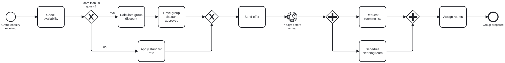

# EB-Q3-4: Hotel group booking

Basic exam, Q3, Version D · 12 points · 20 minutes · Industry: services

## Task

A hotel accepts bookings from tour groups. When a group enquiry has been received, reservations checks availability. If more than 20 guests are travelling, reservations calculates a group discount and then has it approved by the management. Otherwise it applies the standard rate. Reservations then sends the offer. Seven days before arrival, reservations requests the rooming list while housekeeping schedules the cleaning team at the same time. When both are done, reservations assigns the rooms. The group is then prepared. Model the process. Roles do not need to be shown.

## Solution

BPMN: [solution.en.bpmn](solution.en.bpmn)

## Scoring

| points | Scoring |
|---|---|
| 1 | Start event named as a state |
| 1 | End event named as the result |
| 1 | All activities named as verb and object |
| 2 | XOR split with question "More than 20 guests?" and yes/no flows |
| 1 | XOR merge before the process continues |
| 2 | Intermediate timer event "7 days before arrival" at the right place |
| 2 | AND split and AND join around the two concurrent tasks |
| 2 | Order of all steps as in the text |
